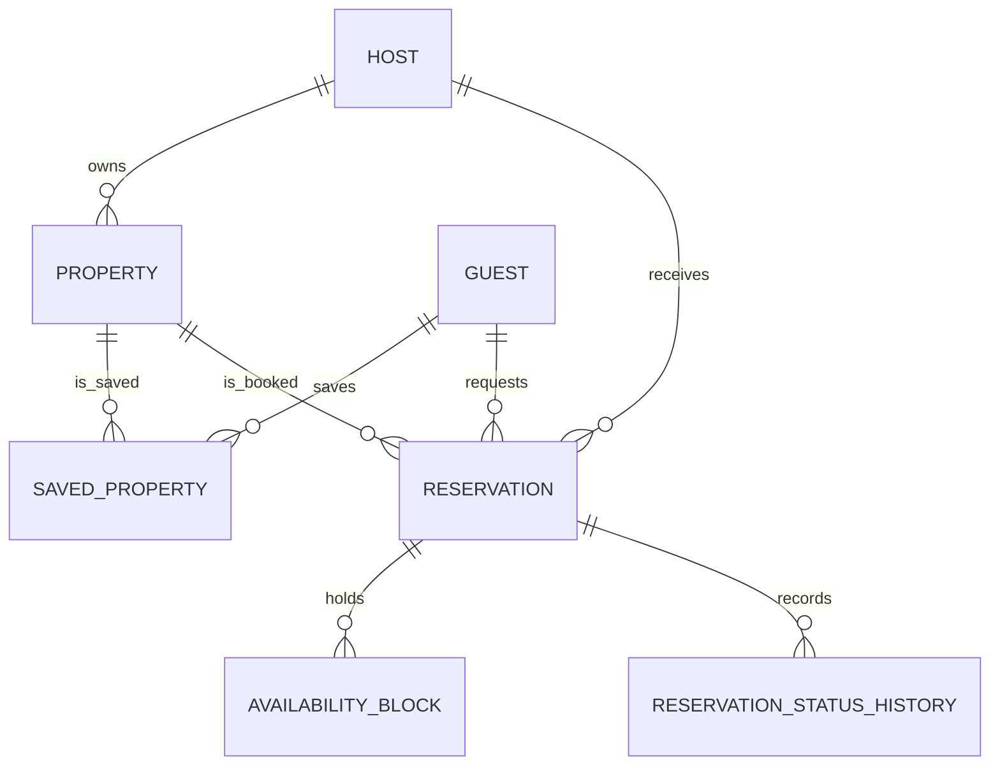

# Airbnb Distributed Platform — API Design Document

DATA 260 · Group 6 · Version 1.0 · 2026-11-02

Source files live in `docs/api/` and `docs/entities.md`; this document is assembled from them.

## Contents

1. [Shared API and Event Conventions](#shared-api-and-event-conventions)
2. [Core Entity Definitions](#core-entity-definitions)
3. [User and Property Service API](#user-and-property-service-api)
4. [Booking and Availability Service API](#booking-and-availability-service-api)
5. [Messaging and Analytics Service API](#messaging-and-analytics-service-api)
6. [Review Service API](#review-service-api)
7. [AI Service API](#ai-service-api)
8. [Agent Payloads](#agent-payloads)

---

## Shared API and Event Conventions

Owner: Matthew — Role C Platform
Status: Week 1 API contract

This document is the source of truth for cross-service HTTP and Kafka conventions. Service-specific documents may add fields, but must not rename these shared fields or change the retry/DLQ rules.

#### HTTP conventions

##### Authentication and identity

- Protected HTTP endpoints require `Authorization: Bearer <JWT>`.
- The authenticated subject and role come from the validated JWT. Services must not trust `guest_id`, `host_id`, or `reviewer_id` supplied in a request body.
- Mutating endpoints that can be retried require `Idempotency-Key: <uuid>`. The key is scoped to the authenticated subject and endpoint.
- JSON field names use `snake_case`. Dates use `YYYY-MM-DD`; timestamps use UTC ISO 8601 with `Z`.

##### Common error body

Every non-2xx response uses this shape:

```json
{
  "error": {
    "code": "DATES_UNAVAILABLE",
    "message": "One or more requested nights are already booked.",
    "trace_id": "tr-01JBOOK001",
    "retryable": false,
    "details": {"property_id": "property-2001"}
  }
}
```

`code` is stable and machine-readable; `message` is safe for logs/UI; `trace_id` correlates the request across services; `retryable` tells a caller whether retrying may succeed; `details` is optional structured context and never contains secrets.

| Status | Meaning |
|---:|---|
| 200 | Successful read, update, response, or idempotent replay |
| 201 | Resource created |
| 202 | Accepted for asynchronous processing |
| 400 | Malformed JSON or invalid field values (`VALIDATION_ERROR`) |
| 401 | Missing or invalid authentication |
| 403 | Authenticated caller lacks permission |
| 404 | Referenced resource does not exist |
| 409 | Conflict, duplicate resource, or invalid state transition |
| 422 | Well-formed request cannot be processed (`CAPACITY_EXCEEDED`, etc.) |
| 429 | Rate limit exceeded; retry after the indicated delay |
| 500 | Unexpected service error; do not expose stack traces |
| 503 | Dependency or infrastructure unavailable; retryable |

##### Pagination

Collection endpoints accept `page` (1-based, default 1) and `page_size` (default 20, maximum 50). Responses include `items`, `page`, `page_size`, and `total`:

```json
{"items": [], "page": 1, "page_size": 20, "total": 0}
```

#### Kafka conventions

##### Event envelope

Every Kafka record value is a JSON object validated against `shared/envelope.schema.json`:

```json
{
  "event_type": "booking.requested",
  "trace_id": "tr-01JBOOK001",
  "timestamp": "2026-11-10T17:00:00.120Z",
  "actor_id": "guest-1001",
  "entity": {"entity_type": "reservation", "entity_id": "res-01JBOOK001"},
  "payload": {"reservation_id": "res-01JBOOK001", "property_id": "property-2001"},
  "idempotency_key": "booking.requested:res-01JBOOK001",
  "attempt": 1,
  "event_id": "ev-01JBOOK001",
  "producer": "booking-api",
  "schema_version": "1.0"
}
```

Required fields are `event_type`, `trace_id`, `timestamp`, `actor_id`, `entity`, `payload`, `idempotency_key`, `attempt`, `event_id`, `producer`, and `schema_version`. `attempt` starts at 1. `event_id` identifies the record; `idempotency_key` identifies the logical operation and remains stable across delivery retries.

The Kafka record key is not duplicated in the envelope. Domain events use the key specified in the topic table below. Consumers must reject a record when the Kafka key does not match the event's required payload key.

##### Topic, key, and consumer-group registry

| Topic | Producer | Consumers | Kafka key | Consumer group(s) |
|---|---|---|---|---|
| `booking.requested` | Booking API | Booking worker | `property_id` | `booking-worker` |
| `booking.updated` | Booking worker/API | WebSocket gateway, Analytics, Messaging | `property_id` | `booking-status`, `analytics`, `messaging` |
| `property.viewed` | Property service | Analytics | `property_id` | `analytics` |
| `property.saved` | Property service | Analytics | `property_id` | `analytics` |
| `property.updated` | Property service | Analytics, cache invalidator | `property_id` | `analytics`, `property-cache` |
| `property.availability.updated` | Booking service | Property/cache, Analytics | `property_id` | `property-cache`, `analytics` |
| `review.created` | Review service | Property service, Analytics | `property_id` | `property-rating`, `analytics` |
| `review.responded` | Review service | Analytics | `property_id` | `analytics` |
| `message.created` | Messaging service | Analytics, notification worker | `conversation_id` | `analytics`, `notifications` |
| `ai.requests` | AI API | Parser, Chair | `trace_id` | `ai-parser`, `ai-chair` |
| `ai.parsed` | Parser | Chair, analysis agents | `trace_id` | `ai-chair`, `ai-agents` |
| `debate.round.0` | Analysis agents | Chair | `trace_id` | `ai-chair` |
| `debate.round.1` | Chair | Analysis agents | `trace_id` | `ai-agents` |
| `debate.round.2` | Analysis agents | Chair | `trace_id` | `ai-chair` |
| `ai.results` | Chair | AI API, WebSocket gateway, Analytics | `trace_id` | `ai-results`, `analytics` |
| `ai.approvals` | AI API | Audit, Analytics | `trace_id` | `audit`, `analytics` |
| `platform.dlq` | Failed consumer | Operations/platform dashboard | original record key | `platform-ops` |

All events for one property or trace remain ordered within their topic partition. Consumers must not assume that different topics are globally ordered.

##### Validation, retry, idempotency, and DLQ

1. Validate the envelope and payload before business processing. Malformed or semantically invalid messages are not retried.
2. Deduplicate using `idempotency_key` within each consumer group. A duplicate is acknowledged without repeating the side effect.
3. Retry transient failures in place up to three times with delays of 200 ms, 1 s, and 5 s. A dependency outage may be retried by the service's bounded publisher using the same event and idempotency key.
4. After the retry limit, publish one record to `platform.dlq`, preserving the full original envelope.
5. Commit the source offset only after the side effect is durable, or after the invalid/permanently failed record is safely written to the DLQ.

A DLQ payload contains `original_topic`, `original_partition`, `original_offset`, `original_key`, `original_event`, `error_code`, `error_message`, `retry_count`, `failed_at`, and `consumer_group`. It must preserve the original `event_id` and `trace_id`. Secrets and credentials must never be copied into the DLQ.

Non-retryable examples: schema failure, missing required field, unknown event type, key/payload mismatch, and permanently invalid business data. Retryable examples: connection reset, timeout, temporary database deadlock, and unavailable dependency.

#### Change control

Adding a field is backward-compatible when it is optional. Renaming a field, changing a topic/key, or changing retry/DLQ behavior requires updating this file and every affected service contract in the same API-design change.


---

## Core Entity Definitions

Owners: Xuanhua Li (Role A) and Ayushi Shringi (Role B)
Status: Final v1.0

#### Purpose

This document defines the shared domain entities used by the User, Property, and Booking services. It keeps field names, identifiers, relationships, and validation rules consistent across service APIs.

Detailed request and response examples remain in:

- `docs/api/user_property.md`
- `docs/api/booking.md`

Operational records such as REST idempotency keys and Kafka processed-event records are documented in the owning API files and are not treated as core domain entities here.

#### Shared Data Conventions

- JSON field names use `snake_case`.
- IDs are server-generated opaque strings.
- Reservation IDs use `res-` followed by a ULID.
- Dates use `YYYY-MM-DD`.
- Timestamps use UTC ISO 8601 format.
- `check_in` is inclusive and `check_out` is exclusive.
- Monetary values are represented as JSON numbers and stored as `DECIMAL(10,2)`.
- Cross-service references are logical references. The owning service validates them through internal service interfaces rather than trusting client-provided data.
- Caller identity comes from the authenticated JWT and is not trusted from request bodies.

#### Entity Ownership

| Entity | Source of Truth | Storage | Purpose |
|---|---|---|---|
| Guest | User Service | MySQL | Guest profile and search preferences |
| Host | User Service | MySQL | Host profile and verification information |
| Property | Property Service | MySQL | Listing information, price, capacity, and rating aggregate |
| Saved Property | Property Service | MySQL | Guest-to-property saved relationship |
| Reservation | Booking Service | MySQL | Booking request, price snapshot, and status |
| Availability Block | Booking Service | MySQL | Authoritative per-night double-booking guard |
| Reservation Status History | Booking Service | MySQL | Audit history for reservation status changes |
| Availability Result | Property Service | Redis or response projection | Temporary date-range availability result |

#### Entity Relationships


```

## Guest

Source of truth: User Service.

| Field | Type | Required | Rule |
|---|---|---:|---|
| `guest_id` | string | Yes | Server-generated and unique |
| `first_name` | string | Yes | 1–100 characters |
| `last_name` | string | Yes | 1–100 characters |
| `email` | string | Yes | Valid email and unique |
| `phone` | string or null | No | E.164 format when present |
| `location` | string or null | No | Maximum 200 characters |
| `profile_photo_url` | string or null | No | HTTPS URL when present |
| `preferences` | object | No | Guest search preferences |
| `saved_properties_count` | integer | Yes | Server-maintained and at least 0 |
| `booking_count` | integer | Yes | Server-maintained and at least 0 |
| `profile_created_datetime` | timestamp | Yes | Server-generated |
| `updated_datetime` | timestamp | Yes | Server-generated |

### Guest Preferences

| Field | Type | Required | Rule |
|---|---|---:|---|
| `property_types` | string[] | No | Values must use supported property types |
| `required_amenities` | string[] | No | Normalized unique values |
| `max_nightly_price` | number | No | Greater than 0 when present |

A guest profile cannot be deleted while the guest has an active reservation. The User Service checks the Booking Service before deletion.

## Host

Source of truth: User Service.

| Field | Type | Required | Rule |
|---|---|---:|---|
| `host_id` | string | Yes | Server-generated and unique |
| `name` | string | Yes | 1–150 characters |
| `email` | string | Yes | Valid email and unique |
| `phone` | string or null | No | E.164 format when present |
| `profile_photo_url` | string or null | No | HTTPS URL when present |
| `verification_status` | string | Yes | `pending`, `verified`, or `rejected` |
| `response_rate` | number | Yes | Server-maintained value from 0 to 1 |
| `response_time` | integer or null | No | Average response time in minutes |
| `host_since` | date | Yes | Server-generated |
| `access_level` | string | Yes | `host` or `admin` |
| `updated_datetime` | timestamp | Yes | Server-generated |

One host can own multiple properties. Only the owning host or an administrator may modify a property.

## Property

Source of truth: Property Service.

| Field | Type | Required | Rule |
|---|---|---:|---|
| `property_id` | string | Yes | Server-generated and unique |
| `host_id` | string | Yes | References an existing host |
| `title` | string | Yes | 5–150 characters |
| `description` | string | Yes | 20–5000 characters |
| `property_type` | string | Yes | `apartment`, `house`, `condo`, `cabin`, or `room` |
| `location` | object | Yes | Address and geographic information |
| `capacity` | integer | Yes | 1–30 |
| `bedrooms` | integer | Yes | 0–20 |
| `bathrooms` | number | Yes | 0.5–20 |
| `amenities` | string[] | Yes | Normalized unique values |
| `nightly_price` | number | Yes | Greater than 0 |
| `cleaning_fee` | number | Yes | At least 0 |
| `availability` | string | Yes | `available`, `partially_available`, or `unavailable` |
| `status` | string | Yes | `draft`, `active`, `suspended`, or `archived` |
| `rating` | number | Yes | Server-maintained value from 0 to 5 |
| `review_count` | integer | Yes | Server-maintained and at least 0 |
| `version` | integer | Yes | Incremented on every update |
| `created_datetime` | timestamp | Yes | Server-generated |
| `updated_datetime` | timestamp | Yes | Server-generated |

### Property Location

| Field | Type | Required | Rule |
|---|---|---:|---|
| `address_line_1` | string | Yes | Street address |
| `city` | string | Yes | City name |
| `state` | string | Yes | State or region |
| `postal_code` | string | Yes | Postal code |
| `country` | string | Yes | Country code |
| `latitude` | number | Yes | Geographic latitude |
| `longitude` | number | Yes | Geographic longitude |

The Property Service consumes `review.created` events to update `rating` and `review_count` idempotently.

The `availability` field is a listing-level summary. It is not the authoritative answer for a requested date range. Date-specific availability must be checked with the Booking Service.

A property cannot be archived while it has an active reservation.

## Saved Property

Source of truth: Property Service.

| Field | Type | Required | Rule |
|---|---|---:|---|
| `guest_id` | string | Yes | References an existing guest |
| `property_id` | string | Yes | References an existing property |
| `saved_datetime` | timestamp | Yes | Server-generated |

The composite pair `(guest_id, property_id)` is unique. Saving the same property again must not create a duplicate relationship.

## Reservation

Source of truth: Booking Service.

| Field | Type | Required | Rule |
|---|---|---:|---|
| `reservation_id` | string | Yes | `res-` followed by a ULID |
| `property_id` | string | Yes | References an existing active property |
| `guest_id` | string | Yes | Taken from the authenticated JWT |
| `host_id` | string | Yes | Copied from the Property Service |
| `check_in` | date | Yes | Inclusive and not in the past |
| `check_out` | date | Yes | Exclusive and later than `check_in` |
| `nights` | integer | Yes | `check_out - check_in`; maximum 30 |
| `guest_count` | integer | Yes | From 1 to the property capacity |
| `nightly_price` | number | Yes | Price snapshot taken at request time |
| `cleaning_fee` | number | Yes | Fee snapshot taken at request time |
| `total_price` | number | Yes | `nightly_price × nights + cleaning_fee` |
| `status` | string | Yes | Reservation lifecycle status |
| `status_reason` | string or null | No | Machine-readable transition reason |
| `message_to_host` | string or null | No | Maximum 1000 characters |
| `cancelled_by` | string or null | No | `guest` or `host` when cancelled |
| `trace_id` | string | Yes | Trace of the original request |
| `publish_pending` | boolean | Yes | Whether an outgoing event still needs publishing |
| `version` | integer | Yes | Incremented on every status change |
| `created_datetime` | timestamp | Yes | Server-generated |
| `updated_datetime` | timestamp | Yes | Server-generated |

The Booking Service copies `host_id`, `nightly_price`, and `cleaning_fee` into the reservation. These values are not accepted from the client. Price snapshots preserve the agreed booking price even if the property price changes later.

### Reservation Status Values

| Status | Meaning | Nights Held |
|---|---|---:|
| `requested` | Accepted and waiting for worker processing | No |
| `pending_host` | Dates held and waiting for the host | Yes |
| `confirmed` | Host approved the reservation | Yes |
| `rejected` | Worker found a date conflict | No |
| `declined` | Host declined the reservation | No |
| `cancelled` | Guest or host cancelled the reservation | No |
| `completed` | Confirmed stay has passed its checkout date | Historical only |

### Allowed Status Transitions

- `requested` → `pending_host`
- `requested` → `rejected`
- `pending_host` → `confirmed`
- `pending_host` → `declined`
- `pending_host` → `cancelled`
- `confirmed` → `cancelled`
- `confirmed` → `completed`

Any other transition is invalid.

An active reservation is a reservation with status `requested`, `pending_host`, or `confirmed` and a `check_out` date of today or later.

## Availability Block

Source of truth: Booking Service.

One availability block represents one held night for one property.

| Field | Type | Required | Rule |
|---|---|---:|---|
| `property_id` | string | Yes | References the reserved property |
| `night_date` | date | Yes | One held night |
| `reservation_id` | string | Yes | References the reservation holding the night |
| `created_datetime` | timestamp | Yes | Server-generated |

The composite primary key is:

```text
(property_id, night_date)
```

This database constraint prevents two reservations from holding the same property night, including when multiple booking workers process requests concurrently.

Availability blocks exist for `pending_host` and `confirmed` reservations. They are released when a reservation is declined or cancelled.

## Reservation Status History

Source of truth: Booking Service.

| Field | Type | Required | Rule |
|---|---|---:|---|
| `id` | integer | Yes | Auto-incremented primary key |
| `reservation_id` | string | Yes | References an existing reservation |
| `from_status` | string or null | No | Previous status; null for initial creation |
| `to_status` | string | Yes | New reservation status |
| `actor_id` | string | Yes | Guest, host, `booking-worker`, or `completion-job` |
| `reason` | string or null | No | Transition reason |
| `trace_id` | string | Yes | Associated request or event trace |
| `changed_datetime` | timestamp | Yes | Server-generated |

Every reservation status transition creates exactly one history record.

## Availability Result

The Availability Result is a read model returned by the Property Service. It may be temporarily stored in Redis, but it is not an authoritative booking record.

| Field | Type | Required | Rule |
|---|---|---:|---|
| `property_id` | string | Yes | References an existing property |
| `check_in` | date | Yes | Inclusive start date |
| `check_out` | date | Yes | Exclusive end date |
| `available` | boolean | Yes | Availability at check time |
| `checked_datetime` | timestamp | Yes | Time of the availability check |
| `source` | string | Yes | `booking_service`, `cache`, or `seed` |

The Property Service invalidates affected Redis entries after consuming `property.availability.updated`.

A positive availability result does not hold the requested dates. The Booking Service must revalidate the dates and create the availability blocks before a reservation can proceed.

## Cross-Service Integrity Rules

1. The User Service owns Guest and Host profile data.
2. The Property Service owns listing data and saved-property relationships.
3. The Booking Service is the only authority for reservation status and date-specific availability.
4. Client requests cannot provide trusted `guest_id`, `host_id`, price snapshots, rating aggregates, or server timestamps.
5. Cross-service IDs are validated through internal service APIs.
6. Property search availability is informational and may be cached.
7. The `(property_id, night_date)` database key is the final double-booking guarantee.
8. Event consumers use idempotency keys so redelivered events do not apply the same change twice.


---

## User and Property Service API

Owner: Xuanhua Li
Role: A — Listings & Search
Status: Final v1.0

#### Scope

The User Service manages guest and host profiles. The Property Service manages property listings, property search, saved properties, and availability lookup.

The services store transactional user and property data in MySQL. They publish property activity events through Kafka and consume `review.created` events to keep each property's aggregate `rating` and `review_count` current.

The Property Service does not confirm reservations. Availability returned by this service is informational and must be revalidated by the Booking Service before a reservation is created or approved.

#### Shared Conventions

Authentication, pagination, error-body, event-envelope, retry, and dead-letter conventions follow `docs/api/00_conventions.md`.

Until that file is finalized, this document follows the conventions already used in `docs/api/ai.md`:

- JSON request and response bodies use `snake_case`.
- Timestamps use UTC ISO 8601 format.
- Dates use `YYYY-MM-DD`.
- IDs are generated by the server.
- Protected endpoints use `Authorization: Bearer <JWT>`.
- Mutation endpoints use an `Idempotency-Key` header when noted.
- The caller identity is taken from the validated JWT and is not trusted from the request body.
- Kafka messages use the shared event envelope defined in §6.2 of the project requirements.

##### Common Error Body

```json
{
  "error": {
    "code": "PROPERTY_NOT_FOUND",
    "message": "The requested property does not exist.",
    "trace_id": "tr-01JPROP001",
    "retryable": false,
    "details": {
      "property_id": "property-2001"
    }
  }
}
```

#### Data Models

##### Guest

| Field | Type | Rule |
|---|---|---|
| `guest_id` | string | Server-generated, unique |
| `first_name` | string | Required, 1–100 characters |
| `last_name` | string | Required, 1–100 characters |
| `email` | string | Required, valid email, unique |
| `phone` | string | Optional, E.164 format when present |
| `location` | string | Optional, maximum 200 characters |
| `profile_photo_url` | string \| null | Valid HTTPS URL when present |
| `preferences` | object | Optional search preferences |
| `saved_properties_count` | integer | Server-maintained, minimum 0 |
| `booking_count` | integer | Server-maintained, minimum 0 |
| `profile_created_datetime` | string | Server-generated UTC timestamp |
| `updated_datetime` | string | Server-generated UTC timestamp |

Example:

```json
{
  "guest_id": "guest-1001",
  "first_name": "Jordan",
  "last_name": "Lee",
  "email": "jordan.lee@example.com",
  "phone": "+14085550101",
  "location": "San Jose, CA",
  "profile_photo_url": null,
  "preferences": {
    "property_types": ["apartment", "condo"],
    "required_amenities": ["parking", "kitchen"],
    "max_nightly_price": 250.0
  },
  "saved_properties_count": 2,
  "booking_count": 1,
  "profile_created_datetime": "2026-10-30T18:00:00Z",
  "updated_datetime": "2026-10-30T18:00:00Z"
}
```

##### Host

| Field | Type | Rule |
|---|---|---|
| `host_id` | string | Server-generated, unique |
| `name` | string | Required, 1–150 characters |
| `email` | string | Required, valid email, unique |
| `phone` | string | Optional, E.164 format when present |
| `profile_photo_url` | string \| null | Valid HTTPS URL when present |
| `verification_status` | string | `pending`, `verified`, or `rejected` |
| `response_rate` | number | Server-maintained, 0–1 |
| `response_time` | integer \| null | Average response time in minutes |
| `host_since` | string | Server-generated UTC date |
| `access_level` | string | `host` or `admin` |
| `updated_datetime` | string | Server-generated UTC timestamp |

Example:

```json
{
  "host_id": "host-501",
  "name": "Taylor Morgan",
  "email": "taylor.morgan@example.com",
  "phone": "+14085550155",
  "profile_photo_url": null,
  "verification_status": "verified",
  "response_rate": 0.96,
  "response_time": 35,
  "host_since": "2026-01-15",
  "access_level": "host",
  "updated_datetime": "2026-10-30T18:00:00Z"
}
```

##### Property

| Field | Type | Rule |
|---|---|---|
| `property_id` | string | Server-generated, unique |
| `host_id` | string | Required, references an existing host |
| `title` | string | Required, 5–150 characters |
| `description` | string | Required, 20–5000 characters |
| `property_type` | string | `apartment`, `house`, `condo`, `cabin`, or `room` |
| `location` | object | Required address and geographic information |
| `capacity` | integer | Required, 1–30 |
| `bedrooms` | integer | Required, 0–20 |
| `bathrooms` | number | Required, 0.5–20 |
| `amenities` | string[] | Normalized, unique values |
| `nightly_price` | number | Required, greater than 0 |
| `cleaning_fee` | number | Minimum 0 |
| `availability` | string | `available`, `partially_available`, or `unavailable` |
| `status` | string | `draft`, `active`, `suspended`, or `archived` |
| `rating` | number | Server-maintained, 0–5 |
| `review_count` | integer | Server-maintained, minimum 0 |
| `version` | integer | Incremented on every update |
| `created_datetime` | string | Server-generated UTC timestamp |
| `updated_datetime` | string | Server-generated UTC timestamp |

Example:

```json
{
  "property_id": "property-2001",
  "host_id": "host-501",
  "title": "Downtown San Jose Apartment",
  "description": "Two-bedroom apartment near downtown with parking and a full kitchen.",
  "property_type": "apartment",
  "location": {
    "address_line_1": "100 Example Street",
    "city": "San Jose",
    "state": "CA",
    "postal_code": "95113",
    "country": "US",
    "latitude": 37.3382,
    "longitude": -121.8863
  },
  "capacity": 4,
  "bedrooms": 2,
  "bathrooms": 1.5,
  "amenities": ["parking", "kitchen", "wifi"],
  "nightly_price": 220.0,
  "cleaning_fee": 45.0,
  "availability": "available",
  "status": "active",
  "rating": 4.7,
  "review_count": 36,
  "version": 3,
  "created_datetime": "2026-09-01T18:00:00Z",
  "updated_datetime": "2026-10-30T18:00:00Z"
}
```

##### Saved Property

| Field | Type | Rule |
|---|---|---|
| `guest_id` | string | References an existing guest |
| `property_id` | string | References an existing property |
| `saved_datetime` | string | Server-generated UTC timestamp |

The pair `(guest_id, property_id)` is unique.

##### Availability Result

| Field | Type | Rule |
|---|---|---|
| `property_id` | string | Existing property |
| `check_in` | string | Inclusive start date |
| `check_out` | string | Exclusive end date |
| `available` | boolean | Current availability result |
| `checked_datetime` | string | UTC timestamp |
| `source` | string | `booking_service`, `cache`, or `seed` |

`check_out` must be later than `check_in`. Availability is revalidated by the Booking Service before booking confirmation.

### User Service REST API

#### POST `/guests/create`

Creates a guest profile.

Headers:

```text
Authorization: Bearer <JWT>
Idempotency-Key: <uuid>
```

Request:

```json
{
  "first_name": "Jordan",
  "last_name": "Lee",
  "email": "jordan.lee@example.com",
  "phone": "+14085550101",
  "location": "San Jose, CA",
  "profile_photo_url": null,
  "preferences": {
    "property_types": ["apartment"],
    "required_amenities": ["parking", "kitchen"],
    "max_nightly_price": 250.0
  }
}
```

Response `201 Created`:

```json
{
  "guest_id": "guest-1001",
  "first_name": "Jordan",
  "last_name": "Lee",
  "email": "jordan.lee@example.com",
  "phone": "+14085550101",
  "location": "San Jose, CA",
  "profile_photo_url": null,
  "preferences": {
    "property_types": ["apartment"],
    "required_amenities": ["parking", "kitchen"],
    "max_nightly_price": 250.0
  },
  "saved_properties_count": 0,
  "booking_count": 0,
  "profile_created_datetime": "2026-10-30T18:00:00Z",
  "updated_datetime": "2026-10-30T18:00:00Z"
}
```

Validation and errors:

- Invalid or missing fields → `400 VALIDATION_ERROR`
- Invalid JWT → `401 UNAUTHORIZED`
- Email already exists → `409 EMAIL_ALREADY_EXISTS`
- MySQL unavailable → `503 DEPENDENCY_UNAVAILABLE`
- Repeated `Idempotency-Key` returns the original guest with `200`

#### POST `/guests/get`

Returns one guest profile.

Request:

```json
{
  "guest_id": "guest-1001"
}
```

Response `200 OK`:

```json
{
  "guest_id": "guest-1001",
  "first_name": "Jordan",
  "last_name": "Lee",
  "email": "jordan.lee@example.com",
  "phone": "+14085550101",
  "location": "San Jose, CA",
  "profile_photo_url": null,
  "preferences": {
    "property_types": ["apartment"],
    "required_amenities": ["parking", "kitchen"],
    "max_nightly_price": 250.0
  },
  "saved_properties_count": 2,
  "booking_count": 1,
  "profile_created_datetime": "2026-10-30T18:00:00Z",
  "updated_datetime": "2026-10-30T18:00:00Z"
}
```

Unknown guest → `404 GUEST_NOT_FOUND`.

A guest may read their own complete profile. Administrative access follows the shared authorization convention.

#### POST `/guests/update`

Updates the authenticated guest's editable profile fields.

Headers:

```text
Authorization: Bearer <JWT>
Idempotency-Key: <uuid>
```

Request:

```json
{
  "guest_id": "guest-1001",
  "phone": "+14085550102",
  "location": "Santa Clara, CA",
  "preferences": {
    "property_types": ["apartment", "condo"],
    "required_amenities": ["parking", "kitchen", "wifi"],
    "max_nightly_price": 275.0
  }
}
```

Response `200 OK` returns the updated Guest object.

Errors:

- Invalid fields → `400 VALIDATION_ERROR`
- Invalid JWT → `401 UNAUTHORIZED`
- JWT subject does not own the profile → `403 NOT_PROFILE_OWNER`
- Guest not found → `404 GUEST_NOT_FOUND`
- Conflicting email → `409 EMAIL_ALREADY_EXISTS`

Server-maintained fields such as `guest_id`, `saved_properties_count`, `booking_count`, and `profile_created_datetime` cannot be changed by the client.

#### POST `/guests/delete`

Soft-deletes the authenticated guest profile. Historical reservations and event traces remain available for audit purposes.

Headers:

```text
Authorization: Bearer <JWT>
Idempotency-Key: <uuid>
```

Request:

```json
{
  "guest_id": "guest-1001"
}
```

Response `200 OK`:

```json
{
  "guest_id": "guest-1001",
  "deleted": true,
  "deleted_datetime": "2026-10-30T19:00:00Z"
}
```

Errors:

- Invalid JWT → `401 UNAUTHORIZED`
- JWT subject does not own the profile → `403 NOT_PROFILE_OWNER`
- Guest not found → `404 GUEST_NOT_FOUND`
- Active reservation prevents deletion → `409 ACTIVE_RESERVATION_EXISTS`

#### POST `/guests/search`

Searches guest profiles. This endpoint requires administrative or approved service access.

Request:

```json
{
  "name": "Jordan",
  "email": null,
  "location": "San Jose",
  "page": 1,
  "page_size": 20
}
```

Response `200 OK`:

```json
{
  "items": [
    {
      "guest_id": "guest-1001",
      "first_name": "Jordan",
      "last_name": "Lee",
      "location": "San Jose, CA",
      "profile_photo_url": null
    }
  ],
  "page": 1,
  "page_size": 20,
  "total": 1
}
```

Rules:

- `page` must be at least 1.
- `page_size` must be 1–50.
- Unauthorized access → `403 FORBIDDEN`.

#### POST `/hosts/create`

Creates a host profile.

Headers:

```text
Authorization: Bearer <JWT>
Idempotency-Key: <uuid>
```

Request:

```json
{
  "name": "Taylor Morgan",
  "email": "taylor.morgan@example.com",
  "phone": "+14085550155",
  "profile_photo_url": null
}
```

Response `201 Created`:

```json
{
  "host_id": "host-501",
  "name": "Taylor Morgan",
  "email": "taylor.morgan@example.com",
  "phone": "+14085550155",
  "profile_photo_url": null,
  "verification_status": "pending",
  "response_rate": 0.0,
  "response_time": null,
  "host_since": "2026-10-30",
  "access_level": "host",
  "updated_datetime": "2026-10-30T18:00:00Z"
}
```

Errors:

- Invalid fields → `400 VALIDATION_ERROR`
- Invalid JWT → `401 UNAUTHORIZED`
- Email already exists → `409 EMAIL_ALREADY_EXISTS`

The client cannot set `verification_status`, `response_rate`, `response_time`, `host_since`, or `access_level`.

#### POST `/hosts/get`

Request:

```json
{
  "host_id": "host-501"
}
```

Response `200 OK` returns the Host object.

Unknown host → `404 HOST_NOT_FOUND`.

#### POST `/hosts/update`

Updates editable host-profile fields.

Headers:

```text
Authorization: Bearer <JWT>
Idempotency-Key: <uuid>
```

Request:

```json
{
  "host_id": "host-501",
  "phone": "+14085550156",
  "profile_photo_url": "https://example.com/host-501.jpg"
}
```

Response `200 OK` returns the updated Host object.

Errors:

- Invalid fields → `400 VALIDATION_ERROR`
- Invalid JWT → `401 UNAUTHORIZED`
- JWT subject does not own the host profile → `403 NOT_PROFILE_OWNER`
- Host not found → `404 HOST_NOT_FOUND`
- Conflicting email → `409 EMAIL_ALREADY_EXISTS`

### Property Service REST API

#### POST `/properties/create`

Creates a property listing for the authenticated host.

Headers:

```text
Authorization: Bearer <JWT>
Idempotency-Key: <uuid>
```

Request:

```json
{
  "title": "Downtown San Jose Apartment",
  "description": "Two-bedroom apartment near downtown with parking and a full kitchen.",
  "property_type": "apartment",
  "location": {
    "address_line_1": "100 Example Street",
    "city": "San Jose",
    "state": "CA",
    "postal_code": "95113",
    "country": "US",
    "latitude": 37.3382,
    "longitude": -121.8863
  },
  "capacity": 4,
  "bedrooms": 2,
  "bathrooms": 1.5,
  "amenities": ["parking", "kitchen", "wifi"],
  "nightly_price": 220.0,
  "cleaning_fee": 45.0
}
```

The `host_id` is taken from the authenticated JWT and is not accepted from the request body.

Response `201 Created` returns the complete Property object with:

```json
{
  "property_id": "property-2001",
  "host_id": "host-501",
  "status": "draft",
  "rating": 0.0,
  "review_count": 0,
  "version": 1
}
```

The response also includes all submitted property fields and server timestamps.

Errors:

- Invalid fields → `400 VALIDATION_ERROR`
- Invalid JWT → `401 UNAUTHORIZED`
- Authenticated user has no host profile → `403 HOST_PROFILE_REQUIRED`
- Host not found → `404 HOST_NOT_FOUND`
- Repeated `Idempotency-Key` returns the original property with `200`

#### POST `/properties/get`

Returns property details.

Request:

```json
{
  "property_id": "property-2001"
}
```

Response `200 OK` returns the complete Property object.

Errors:

- Property not found → `404 PROPERTY_NOT_FOUND`
- Archived property requested by a non-owner → `404 PROPERTY_NOT_FOUND`

A successful guest-facing request publishes `property.viewed` when an authenticated guest is present.

#### POST `/properties/update`

Updates a property owned by the authenticated host.

Headers:

```text
Authorization: Bearer <JWT>
Idempotency-Key: <uuid>
```

Request:

```json
{
  "property_id": "property-2001",
  "expected_version": 3,
  "changes": {
    "nightly_price": 235.0,
    "amenities": ["parking", "kitchen", "wifi", "washer"],
    "status": "active"
  }
}
```

Response `200 OK`:

```json
{
  "property_id": "property-2001",
  "version": 4,
  "nightly_price": 235.0,
  "amenities": ["parking", "kitchen", "wifi", "washer"],
  "status": "active",
  "updated_datetime": "2026-10-30T20:00:00Z"
}
```

Errors:

- Invalid fields → `400 VALIDATION_ERROR`
- Invalid JWT → `401 UNAUTHORIZED`
- Authenticated host does not own the property → `403 NOT_PROPERTY_HOST`
- Property not found → `404 PROPERTY_NOT_FOUND`
- `expected_version` does not match → `409 PROPERTY_VERSION_CONFLICT`

A successful update publishes `property.updated`. Price, status, amenity, and location changes invalidate matching Redis search-cache entries.

The client cannot directly modify `host_id`, `rating`, `review_count`, `created_datetime`, or `version`.

#### POST `/properties/delete`

Soft-deletes a property by changing its status to `archived`.

Headers:

```text
Authorization: Bearer <JWT>
Idempotency-Key: <uuid>
```

Request:

```json
{
  "property_id": "property-2001",
  "expected_version": 4
}
```

Response `200 OK`:

```json
{
  "property_id": "property-2001",
  "status": "archived",
  "version": 5,
  "deleted_datetime": "2026-10-30T21:00:00Z"
}
```

Errors:

- Invalid JWT → `401 UNAUTHORIZED`
- Authenticated host does not own the property → `403 NOT_PROPERTY_HOST`
- Property not found → `404 PROPERTY_NOT_FOUND`
- Version mismatch → `409 PROPERTY_VERSION_CONFLICT`
- Future or active reservations prevent deletion → `409 ACTIVE_RESERVATION_EXISTS`
- Booking Service unavailable during reservation check → `503 DEPENDENCY_UNAVAILABLE`

Historical bookings, reviews, and traces are not deleted.

#### POST `/properties/search`

Searches active property listings.

Authentication is optional for public browsing. An authenticated guest may receive preference-based ordering only when explicitly requested.

Request:

```json
{
  "location": "San Jose",
  "check_in": "2026-11-20",
  "check_out": "2026-11-22",
  "minimum_nightly_price": 0.0,
  "maximum_nightly_price": 250.0,
  "property_types": ["apartment", "condo"],
  "guest_count": 2,
  "minimum_bedrooms": 1,
  "required_amenities": ["parking", "kitchen"],
  "minimum_rating": 4.5,
  "available_only": true,
  "sort": "rating_desc",
  "page": 1,
  "page_size": 20
}
```

Response `200 OK`:

```json
{
  "items": [
    {
      "property_id": "property-2001",
      "host_id": "host-501",
      "title": "Downtown San Jose Apartment",
      "property_type": "apartment",
      "location": {
        "city": "San Jose",
        "state": "CA",
        "country": "US"
      },
      "capacity": 4,
      "bedrooms": 2,
      "bathrooms": 1.5,
      "amenities": ["parking", "kitchen", "wifi"],
      "nightly_price": 220.0,
      "cleaning_fee": 45.0,
      "rating": 4.7,
      "review_count": 36,
      "available": true
    }
  ],
  "page": 1,
  "page_size": 20,
  "total": 1,
  "sort": "rating_desc",
  "availability_checked_datetime": "2026-10-30T21:00:00Z"
}
```

Allowed sort values:

- `relevance`
- `price_asc`
- `price_desc`
- `rating_desc`
- `property_id_asc`

Rules:

- `check_out` must be later than `check_in`.
- Prices must be non-negative.
- `guest_count` must be at least 1.
- `minimum_rating` must be between 0 and 5.
- `page` must be at least 1.
- `page_size` must be 1–50.
- Unknown filter values → `400 VALIDATION_ERROR`
- Availability dependency unavailable → `503 DEPENDENCY_UNAVAILABLE`

For benchmark and agent requests, the service uses the fixed property pool and `property_id_asc` ordering so every agent receives the same deterministic candidate set.

#### POST `/properties/save`

Saves or removes a property for the authenticated guest.

Headers:

```text
Authorization: Bearer <JWT>
Idempotency-Key: <uuid>
```

Request:

```json
{
  "property_id": "property-2001",
  "saved": true
}
```

Response `200 OK`:

```json
{
  "guest_id": "guest-1001",
  "property_id": "property-2001",
  "saved": true,
  "saved_datetime": "2026-10-30T21:10:00Z",
  "saved_properties_count": 3
}
```

Rules:

- `guest_id` comes from the JWT.
- Repeating the same requested state is successful and does not create a duplicate row.
- Invalid JWT → `401 UNAUTHORIZED`
- Guest profile not found → `404 GUEST_NOT_FOUND`
- Property not found or archived → `404 PROPERTY_NOT_FOUND`

A successful state change publishes `property.saved`. An idempotent replay does not publish a second event.

#### POST `/properties/availability`

Checks whether a property is available for a date range.

Request:

```json
{
  "property_id": "property-2001",
  "check_in": "2026-11-20",
  "check_out": "2026-11-22",
  "guest_count": 2
}
```

Response `200 OK`:

```json
{
  "property_id": "property-2001",
  "check_in": "2026-11-20",
  "check_out": "2026-11-22",
  "guest_count": 2,
  "available": true,
  "checked_datetime": "2026-10-30T21:15:00Z",
  "source": "booking_service"
}
```

Errors:

- Invalid date range or guest count → `400 VALIDATION_ERROR`
- Property not found → `404 PROPERTY_NOT_FOUND`
- Guest count exceeds capacity → `422 CAPACITY_EXCEEDED`
- Booking/Availability Service unavailable → `503 DEPENDENCY_UNAVAILABLE`

This result does not reserve the dates. The Booking Service must revalidate availability inside the booking transaction to prevent double booking.

### Internal Service Interfaces

Internal endpoints require service authentication and are not exposed directly to the browser.

#### GET `/internal/guests/{guest_id}`

Used by the AI Service to validate a guest before creating a recommendation task.

Response `200 OK`:

```json
{
  "guest_id": "guest-1001",
  "exists": true,
  "active": true
}
```

Unknown or deleted guest → `404 GUEST_NOT_FOUND`.

#### POST `/internal/properties/candidates`

Used by the AI analysis agents to retrieve a deterministic candidate set from the fixed property pool.

Request:

```json
{
  "pool_id": "benchmark-200-properties-v1",
  "dataset_version": "2026-10-30",
  "selection_rule": "deterministic_filter_then_property_id",
  "filters": {
    "location": "San Jose",
    "check_in": "2026-11-20",
    "check_out": "2026-11-22",
    "guest_count": 2,
    "maximum_nightly_price": 250.0,
    "required_amenities": ["parking", "kitchen"],
    "minimum_rating": 4.5
  }
}
```

Response `200 OK`:

```json
{
  "pool_id": "benchmark-200-properties-v1",
  "dataset_version": "2026-10-30",
  "selection_rule": "deterministic_filter_then_property_id",
  "candidate_property_ids": [
    "property-2001",
    "property-2007",
    "property-2012"
  ],
  "properties": [
    {
      "property_id": "property-2001",
      "nightly_price": 220.0,
      "location": {
        "city": "San Jose",
        "state": "CA"
      },
      "capacity": 4,
      "amenities": ["parking", "kitchen", "wifi"],
      "rating": 4.7,
      "review_count": 36,
      "available": true
    }
  ]
}
```

Every analysis agent receives the same ordered candidate set. Each agent independently computes and publishes the required `candidate_set_hash`.

### Kafka Events

All events use the shared event envelope. Domain-event Kafka keys use `property_id` so events for the same property remain ordered within a topic partition.

| Topic | Producer | Consumer | Key | Purpose |
|---|---|---|---|---|
| `property.viewed` | Property Service | Analytics | `property_id` | Record authenticated property-detail views |
| `property.saved` | Property Service | Analytics | `property_id` | Record save/unsave activity |
| `property.created` | Property Service | Analytics | `property_id` | Record new listings |
| `property.updated` | Property Service | Analytics and cache invalidation worker | `property_id` | Record listing changes and invalidate search cache |
| `property.archived` | Property Service | Analytics and cache invalidation worker | `property_id` | Remove archived listings from cached results |
| `property.availability.updated` | Booking/Availability Service | Property Service cache worker | `property_id` | Invalidate cached availability/search results |
| `review.created` | Review Service | Property Service and Analytics | `property_id` | Update aggregate rating and review count |

#### `property.viewed` Payload

```json
{
  "property_id": "property-2001",
  "guest_id": "guest-1001",
  "viewed_datetime": "2026-10-30T21:20:00Z"
}
```

#### `property.saved` Payload

```json
{
  "property_id": "property-2001",
  "guest_id": "guest-1001",
  "saved": true,
  "saved_datetime": "2026-10-30T21:21:00Z"
}
```

#### `property.updated` Payload

```json
{
  "property_id": "property-2001",
  "host_id": "host-501",
  "version": 4,
  "changed_fields": ["nightly_price", "amenities"],
  "updated_datetime": "2026-10-30T21:22:00Z"
}
```

### Consumed Event: `review.created`

The Property Service consumes `review.created` after the Review Service successfully creates a review.

- Producer: Review Service
- Consumer: Property Service
- Kafka key: `property_id`
- Purpose: update the property's aggregate `rating` and `review_count`

Example event:

```json
{
  "event_type": "review.created",
  "trace_id": "tr-01JREV001",
  "timestamp": "2026-11-23T18:04:11Z",
  "actor_id": "guest-1001",
  "entity": {
    "entity_type": "review",
    "entity_id": "rev-01JREV001"
  },
  "payload": {
    "review_id": "rev-01JREV001",
    "reservation_id": "res-3001",
    "property_id": "property-2001",
    "host_id": "host-501",
    "rating": 4,
    "tags": ["positive"]
  },
  "idempotency_key": "review.created:rev-01JREV001"
}
```

#### Consumer Validation

The consumer validates:

1. All shared envelope fields are present.
2. `event_type` equals `review.created`.
3. Kafka key equals `payload.property_id`.
4. `rating` is an integer from 1 to 5.
5. `review_id`, `property_id`, and `idempotency_key` are non-empty.
6. The property exists.

Malformed messages follow the shared retry and dead-letter policy.

#### Idempotent Rating Update

The Property Service performs the following steps in one database transaction:

1. Check whether `idempotency_key` has already been processed.
2. If it has been processed, acknowledge the event without changing the property.
3. Lock or safely version-check the property row.
4. Calculate:

```text
new_review_count = old_review_count + 1

new_rating =
    (old_rating * old_review_count + event.rating)
    / new_review_count
```

5. Update `rating`, `review_count`, `version`, and `updated_datetime`.
6. Store the processed `idempotency_key`.
7. Commit the transaction before committing the Kafka offset.

This prevents an at-least-once Kafka redelivery from counting the same review twice.

If the process fails before the database commit, Kafka may replay the event safely. If it fails after the database commit but before the offset commit, the stored `idempotency_key` prevents a duplicate update.

A permanently invalid message is moved to the dead-letter topic with the original `trace_id`, event, and failure reason.

### Redis Cache Contract

The Property Service may cache normalized property-search results and availability lookups.

Rules:

- Cache keys are generated from normalized search filters, pagination, sorting, and dataset version.
- A cache hit may accelerate search but cannot confirm a booking.
- `property.updated`, `property.archived`, and `property.availability.updated` invalidate affected cache entries.
- When Redis is unavailable, the service queries MySQL and the Booking/Availability Service directly.
- Redis failure must not make stale availability appear bookable.
- Cache hit, miss, invalidation count, and latency are recorded for the required performance comparison.

### Status Codes

| Code | Meaning |
|---|---|
| `200` | Successful read/update/delete or idempotent replay |
| `201` | Guest, host, or property created |
| `400` | Missing, malformed, or invalid request fields |
| `401` | Missing or invalid authentication |
| `403` | Caller is not authorized for the requested resource |
| `404` | Guest, host, or property not found |
| `409` | Duplicate record, active dependency, or version conflict |
| `422` | Valid request format but invalid business rule |
| `429` | Rate limit exceeded |
| `503` | MySQL, Kafka, Redis-required operation, or another service unavailable |

### Cross-Service Dependencies

| Needs | From | Interface |
|---|---|---|
| Reservation status and future-booking check | B — Booking | Booking internal API |
| Date-range availability | B — Booking/Availability | Availability lookup and update events |
| Shared auth, error, pagination, envelope, retry, and DLQ rules | C — Platform | `docs/api/00_conventions.md` |
| Guest validation for AI requests | D consumes A | `GET /internal/guests/{guest_id}` |
| Deterministic property candidate pool | D/E consume A | `POST /internal/properties/candidates` |
| Property rating and review-count update | E — Review | Property Service consumes `review.created` |
| Property views, saves, and updates | C — Analytics | Analytics consumes property events |

### Cross-Review Items

Before final approval, the team must confirm:

1. C's final authentication, error-body, pagination, event-envelope, retry, and DLQ conventions.
2. B's final internal availability and future-reservation interfaces.
3. The exact `property.availability.updated` topic name with B and C.
4. D/E acceptance of the two internal User/Property interfaces.
5. Shared entity fields and types in `docs/entities.md`.


---

## Booking and Availability Service API

Owner: Ayushi Shringi
Role: B — Booking & Availability
Status: Final v1.0

#### Scope

The Booking service lets a guest request a stay, lets the host approve or decline it, lets either side cancel, and is the single source of truth for which nights of a property are taken. It owns the MySQL tables `reservations`, `availability_blocks`, `reservation_status_history`, `idempotency_keys` and `processed_events`.

Booking is the project's main asynchronous flow (§6.1):

```text
UI ──POST /bookings/create──▶ Booking API ──booking.requested──▶ Kafka ──▶ Booking Worker ──▶ MySQL
 ▲                                                                              │
 └────────── WebSocket /bookings/stream ◀── booking.updated ◀── Kafka ◀─────────┘
```

The API accepts the request and returns `202 Accepted` immediately. The worker decides whether the dates can be held. The guest's screen updates over WebSocket when the decision is made.

The Property service's availability result is informational only. The Booking worker re-checks availability inside a database transaction, and that check is the only one that can hold dates.

#### Shared Conventions

Authentication, pagination, error-body, event-envelope, retry and dead-letter rules follow `docs/api/00_conventions.md`:

- JSON bodies use `snake_case`; timestamps are UTC ISO 8601; dates are `YYYY-MM-DD`.
- `check_in` is inclusive and `check_out` is exclusive (a stay of 2026-11-20 → 2026-11-22 uses the nights of the 20th and 21st).
- IDs are server-generated: `res-` + ULID for reservations.
- Every endpoint requires `Authorization: Bearer <JWT>`. The guest or host identity always comes from the JWT subject, never from the request body.
- Mutating endpoints require an `Idempotency-Key: <uuid>` header.
- Kafka messages use the shared envelope in `docs/api/00_conventions.md` and must validate against `shared/envelope.schema.json`.

##### Common Error Body

```json
{
  "error": {
    "code": "DATES_UNAVAILABLE",
    "message": "One or more requested nights are already booked.",
    "trace_id": "tr-01JBOOK001",
    "retryable": false,
    "details": {
      "property_id": "property-2001",
      "conflicting_nights": ["2026-11-21"]
    }
  }
}
```

#### Why MySQL (§3.2)

- A booking is a money-and-calendar record: it needs ACID transactions so that holding the nights and changing the reservation status succeed or fail together.
- Double booking is prevented by a database constraint (a unique key on property + night), not by application code alone, so it holds even with several workers and concurrent requests.
- Status changes, refunds and dashboard counts need joins and aggregates (`GROUP BY` status, date ranges), which suit a relational schema.

#### Reservation Status Lifecycle

```text
                    worker holds nights            host approves
 requested ───────────────────────────▶ pending_host ───────────▶ confirmed ───▶ completed
     │                                      │    │                    │        (after check_out,
     │ worker finds conflict                │    │ host declines      │         scheduled job)
     ▼                                      │    ▼                    │
  rejected                                  │  declined               │
                                            │                         │
                                            └──── guest/host cancels ─┴──▶ cancelled
```

| Status | Meaning | Nights held? |
|---|---|---|
| `requested` | Accepted by the API, waiting for the worker | No |
| `pending_host` | Worker held the nights; waiting for the host | Yes |
| `confirmed` | Host approved | Yes |
| `rejected` | Worker found a date conflict (system decision) | No |
| `declined` | Host declined | No (released) |
| `cancelled` | Guest or host cancelled | No (released) |
| `completed` | `check_out` has passed for a confirmed stay | Yes (history) |

Allowed transitions are exactly the arrows above. Any other transition returns `409 INVALID_STATUS_TRANSITION`. Every transition writes one row to `reservation_status_history` and publishes one `booking.updated` event.

`rejected` (system: dates taken) and `declined` (host chose no) are kept separate so the host dashboard can report host decisions without counting system conflicts.

#### Data Model (MySQL)

##### `reservations`

| Field | Type | Rule |
|---|---|---|
| `reservation_id` | VARCHAR(40) PK | `res-` + ULID |
| `property_id` | VARCHAR(40) | required; existing, `active` property |
| `guest_id` | VARCHAR(40) | from JWT |
| `host_id` | VARCHAR(40) | copied from the property, never from the client |
| `check_in` | DATE | inclusive; not in the past |
| `check_out` | DATE | exclusive; later than `check_in`; stay ≤ 30 nights |
| `nights` | INT | `check_out - check_in` |
| `guest_count` | INT | 1 to property `capacity` |
| `nightly_price` | DECIMAL(10,2) | price snapshot at request time |
| `cleaning_fee` | DECIMAL(10,2) | snapshot at request time |
| `total_price` | DECIMAL(10,2) | `nightly_price × nights + cleaning_fee` |
| `status` | ENUM | see lifecycle above |
| `status_reason` | VARCHAR(64) NULL | e.g. `DATES_UNAVAILABLE`, `HOST_DECLINED`, `GUEST_CANCELLED` |
| `message_to_host` | VARCHAR(1000) NULL | optional note from the guest |
| `cancelled_by` | ENUM(`guest`,`host`) NULL | set on cancel |
| `trace_id` | VARCHAR(40) | trace of the create request |
| `publish_pending` | BOOLEAN | `true` while an outgoing event has not been confirmed by Kafka |
| `version` | INT | incremented on every status change |
| `created_datetime` | DATETIME(3) | server |
| `updated_datetime` | DATETIME(3) | server |

Indexes: `(guest_id, created_datetime)`, `(host_id, status, created_datetime)`, `(property_id, check_in)`, `(status, check_out)` for the completion job.

##### `availability_blocks` — the double-booking guard

One row per held night.

| Field | Type | Rule |
|---|---|---|
| `property_id` | VARCHAR(40) | |
| `night_date` | DATE | one night |
| `reservation_id` | VARCHAR(40) | the reservation holding the night |
| `created_datetime` | DATETIME(3) | |

```sql
PRIMARY KEY (property_id, night_date)
```

Because the primary key is `(property_id, night_date)`, MySQL physically cannot store two reservations for the same night of the same property. If two workers try to hold the same night, one insert succeeds and the other fails with a duplicate-key error, even if both requests arrive at the same millisecond.

##### `reservation_status_history`

| Field | Type |
|---|---|
| `id` | BIGINT PK auto-increment |
| `reservation_id` | VARCHAR(40) |
| `from_status` | ENUM NULL |
| `to_status` | ENUM |
| `actor_id` | VARCHAR(40) — guest, host, `booking-worker` or `completion-job` |
| `reason` | VARCHAR(64) NULL |
| `trace_id` | VARCHAR(40) |
| `changed_datetime` | DATETIME(3) |

##### `idempotency_keys` (REST)

| Field | Type | Rule |
|---|---|---|
| `idempotency_key` | VARCHAR(64) | |
| `actor_id` | VARCHAR(40) | from JWT |
| `endpoint` | VARCHAR(64) | e.g. `/bookings/create` |
| `request_hash` | CHAR(64) | SHA-256 of the normalized body |
| `response_code` | INT | |
| `response_body` | JSON | |
| `created_datetime` | DATETIME(3) | rows older than 24 h are purged |

`PRIMARY KEY (actor_id, endpoint, idempotency_key)`.

##### `processed_events` (Kafka consumer)

| Field | Type |
|---|---|
| `idempotency_key` | VARCHAR(128) PK |
| `consumer` | VARCHAR(64) — e.g. `booking-worker` |
| `processed_datetime` | DATETIME(3) |

### REST API

#### POST `/bookings/create`

Guest requests a stay. Asynchronous: the API validates and records the request, publishes `booking.requested`, and returns `202`.

Headers:

```text
Authorization: Bearer <JWT>
Idempotency-Key: <uuid>
```

Request:

```json
{
  "property_id": "property-2001",
  "check_in": "2026-11-20",
  "check_out": "2026-11-22",
  "guest_count": 2,
  "message_to_host": "Visiting for a conference, arriving around 6 pm."
}
```

Validation (in order):

1. Fields present, dates valid, `check_out > check_in`, `check_in` not in the past, stay ≤ 30 nights, `guest_count ≥ 1` → else `400 VALIDATION_ERROR`
2. Property exists and is `active` (Property service `POST /properties/get`) → else `404 PROPERTY_NOT_FOUND`
3. JWT subject is not the property's host → else `403 HOST_CANNOT_BOOK_OWN_PROPERTY`
4. `guest_count ≤ capacity` → else `422 CAPACITY_EXCEEDED`
5. Fast pre-check: none of the nights are already in `availability_blocks` → else `409 DATES_UNAVAILABLE`

Step 5 only fails obviously-taken dates early so the guest gets an immediate answer. It does not hold anything; the worker's transaction is the real check.

On success, in one MySQL transaction the API inserts the reservation with `status = requested` and price snapshot, writes the first status-history row, and stores the idempotency key. It then publishes `booking.requested`.

Response `202 Accepted`:

```json
{
  "reservation_id": "res-01JBOOK001",
  "status": "requested",
  "property_id": "property-2001",
  "check_in": "2026-11-20",
  "check_out": "2026-11-22",
  "nights": 2,
  "guest_count": 2,
  "total_price": 485.0,
  "trace_id": "tr-01JBOOK001",
  "created_datetime": "2026-11-10T17:00:00.120Z"
}
```

The client then listens on `WebSocket /bookings/stream` (or polls `/bookings/get`) for the change to `pending_host` or `rejected`.

Idempotency:

- Same `Idempotency-Key` and same body → the original `202` response is returned; no second reservation and no second event.
- Same key with a different body → `422 IDEMPOTENCY_KEY_REUSED`.
- A different key for an identical request from the same guest (double-click with a new key) creates a second `requested` row, but the worker can hold the nights for only one of them; the other ends as `rejected`.

If Kafka publishing fails, the row keeps `publish_pending = true` and a background publisher retries with the same event `idempotency_key`, so the request is never lost and never processed twice.

#### POST `/bookings/get`

Request: `{ "reservation_id": "res-01JBOOK001" }`

Response `200`:

```json
{
  "reservation_id": "res-01JBOOK001",
  "property_id": "property-2001",
  "guest_id": "guest-1001",
  "host_id": "host-501",
  "check_in": "2026-11-20",
  "check_out": "2026-11-22",
  "nights": 2,
  "guest_count": 2,
  "nightly_price": 220.0,
  "cleaning_fee": 45.0,
  "total_price": 485.0,
  "status": "pending_host",
  "status_reason": null,
  "message_to_host": "Visiting for a conference, arriving around 6 pm.",
  "cancelled_by": null,
  "version": 2,
  "trace_id": "tr-01JBOOK001",
  "created_datetime": "2026-11-10T17:00:00.120Z",
  "updated_datetime": "2026-11-10T17:00:00.480Z",
  "status_history": [
    {"from_status": null, "to_status": "requested", "actor_id": "guest-1001", "reason": null, "changed_datetime": "2026-11-10T17:00:00.120Z"},
    {"from_status": "requested", "to_status": "pending_host", "actor_id": "booking-worker", "reason": null, "changed_datetime": "2026-11-10T17:00:00.480Z"}
  ]
}
```

Only the reservation's guest or host may read it → else `403 NOT_RESERVATION_PARTY`. Unknown ID → `404 RESERVATION_NOT_FOUND`.

#### POST `/bookings/byGuest`

Lists the authenticated guest's reservations.

Request:

```json
{
  "status": ["pending_host", "confirmed"],
  "from_date": null,
  "to_date": null,
  "page": 1,
  "page_size": 20
}
```

Response `200`:

```json
{
  "items": [
    {
      "reservation_id": "res-01JBOOK001",
      "property_id": "property-2001",
      "check_in": "2026-11-20",
      "check_out": "2026-11-22",
      "total_price": 485.0,
      "status": "pending_host",
      "created_datetime": "2026-11-10T17:00:00.120Z"
    }
  ],
  "page": 1,
  "page_size": 20,
  "total": 1
}
```

`status` is optional (all statuses when omitted). `page ≥ 1`, `page_size` 1–50. Sorted by `created_datetime` descending.

#### POST `/bookings/byHost`

Same request and response shape as `/bookings/byGuest`, for reservations on the authenticated host's properties. Adds an optional `property_id` filter. Each item also includes `guest_id` and `guest_count`. A caller without a host profile → `403 HOST_PROFILE_REQUIRED`.

#### POST `/bookings/approve`

Host approves a pending request.

Headers: `Authorization`, `Idempotency-Key`.

Request:

```json
{
  "reservation_id": "res-01JBOOK001",
  "expected_version": 2
}
```

Rules:

- JWT subject is the reservation's `host_id` → else `403 NOT_PROPERTY_HOST`
- Status is `pending_host` → else `409 INVALID_STATUS_TRANSITION`
- `expected_version` matches → else `409 RESERVATION_VERSION_CONFLICT` (protects against approving a request the guest just cancelled)

The update is a guarded single statement:

```sql
UPDATE reservations
SET status = 'confirmed', version = version + 1, updated_datetime = NOW(3)
WHERE reservation_id = ? AND status = 'pending_host' AND version = ?;
-- 0 rows affected → 409
```

Response `200`: the updated reservation object with `status: "confirmed"`. Publishes `booking.updated`.

#### POST `/bookings/decline`

Host declines a pending request.

Request:

```json
{
  "reservation_id": "res-01JBOOK001",
  "expected_version": 2,
  "reason": "Property under maintenance those dates"
}
```

Same authorization and version rules as approve. In one transaction: status → `declined`, `status_reason = HOST_DECLINED`, delete the reservation's rows from `availability_blocks`, write history. Response `200` with the updated reservation. Publishes `booking.updated` and `property.availability.updated`.

#### POST `/bookings/cancel`

Guest or host cancels.

Request:

```json
{
  "reservation_id": "res-01JBOOK001",
  "expected_version": 3,
  "reason": "Travel plans changed"
}
```

Rules:

- Caller is the reservation's guest or host → else `403 NOT_RESERVATION_PARTY`
- Status is `requested`, `pending_host` or `confirmed` → else `409 INVALID_STATUS_TRANSITION`
- A `confirmed` reservation can be cancelled only before `check_in` → else `422 CANCELLATION_WINDOW_CLOSED`

In one transaction: status → `cancelled`, `cancelled_by` set from the caller's role, `status_reason` = `GUEST_CANCELLED` or `HOST_CANCELLED`, release `availability_blocks`, write history. Response `200`. Publishes `booking.updated` and `property.availability.updated`.

Cancelling a `requested` reservation before the worker runs is safe: the worker sees status ≠ `requested`, holds nothing, and acknowledges the event.

The cancellation rule is in one function (`cancellation_policy.py`) so the §13.12 "change the cancel rule" drill touches one place.

#### POST `/bookings/calendar`

Returns the taken nights of a property, for the property detail page and the date picker.

Request:

```json
{
  "property_id": "property-2001",
  "from_date": "2026-11-01",
  "to_date": "2026-12-31"
}
```

Response `200`:

```json
{
  "property_id": "property-2001",
  "from_date": "2026-11-01",
  "to_date": "2026-12-31",
  "unavailable_nights": ["2026-11-20", "2026-11-21"],
  "checked_datetime": "2026-11-10T17:05:00Z"
}
```

Range ≤ 366 days → else `400`. Public read (auth optional). Reservation and guest identities are not exposed.

#### WebSocket `/bookings/stream`

The client authenticates with `Authorization: Bearer <JWT>` during the handshake. The server pushes every `booking.updated` event for reservations where the user is the guest or the host. The message is the shared event envelope (see `booking.updated` below).

The client can also subscribe to a property's calendar to see "dates just taken" live while on the detail page:

```json
{ "action": "subscribe_calendar", "property_id": "property-2001" }
```

The server then forwards `property.availability.updated` for that property. After a disconnect, the client calls `/bookings/get` or `/bookings/calendar` to recover state, so a missed push never leaves the UI wrong.

#### Dashboards (§5, §8)

Both are read-only and computed from MySQL plus the sources named below.

##### POST `/dashboards/guest`

Request: `{ "days": 30 }` (1–365, default 30). Guest from JWT.

Response `200`:

```json
{
  "guest_id": "guest-1001",
  "window_days": 30,
  "bookings_in_window": 3,
  "status_summary": {"requested": 0, "pending_host": 1, "confirmed": 1, "rejected": 0, "declined": 0, "cancelled": 1, "completed": 0},
  "upcoming": [{"reservation_id": "res-01JBOOK001", "property_id": "property-2001", "check_in": "2026-11-20", "status": "confirmed"}],
  "saved_properties_count": 3,
  "total_spent": 485.0
}
```

`saved_properties_count` comes from the User service (`POST /guests/get`).

##### POST `/dashboards/host`

Request: `{ "days": 30, "property_id": null }`. Host from JWT.

Response `200`:

```json
{
  "host_id": "host-501",
  "window_days": 30,
  "funnel": {"views": 420, "saves": 38, "requests": 12, "confirmed": 8},
  "occupancy_rate": 0.62,
  "revenue": 6240.0,
  "cancellations": {"by_guest": 1, "by_host": 0},
  "declined": 2,
  "average_rating": 4.7,
  "median_response_minutes": 35
}
```

| Field | Source |
|---|---|
| `requests`, `confirmed`, `revenue`, `cancellations`, `declined`, `occupancy_rate` | Booking MySQL (`occupancy_rate` = booked nights ÷ available nights of active properties in the window) |
| `median_response_minutes` | Booking: time from `pending_host` to `confirmed`/`declined` in status history |
| `views`, `saves` | Analytics service (C), from `property.viewed` / `property.saved` |
| `average_rating` | Property service (A) aggregate `rating` |

If Analytics is unavailable, `views` and `saves` are returned as `null` and the rest of the dashboard still loads.

### Internal Service Interfaces

Internal endpoints require service authentication and are not exposed to the browser.

#### GET `/internal/reservations/{reservation_id}`

Requested by E (Review service) before creating a review.

Response `200 OK`:

```json
{
  "reservation_id": "res-3001",
  "property_id": "property-2001",
  "guest_id": "guest-1001",
  "host_id": "host-501",
  "status": "completed",
  "check_in": "2026-11-20",
  "check_out": "2026-11-22"
}
```

Unknown ID → `404 RESERVATION_NOT_FOUND`. MySQL unavailable → `503 DEPENDENCY_UNAVAILABLE`.

The Review service checks `guest_id`, `status = completed` and that `check_out` is in the past. A scheduled completion job moves `confirmed` reservations to `completed` every 15 minutes once `check_out` has passed, so a finished stay becomes reviewable without anyone doing anything. For the demo, `make complete-stays` runs the job once.

#### POST `/internal/availability/check`

Requested by A (Property service) for `/properties/availability` and `available_only` search.

Request:

```json
{
  "property_ids": ["property-2001", "property-2007"],
  "check_in": "2026-11-20",
  "check_out": "2026-11-22"
}
```

Response `200 OK`:

```json
{
  "check_in": "2026-11-20",
  "check_out": "2026-11-22",
  "results": [
    {"property_id": "property-2001", "available": false},
    {"property_id": "property-2007", "available": true}
  ],
  "checked_datetime": "2026-11-10T17:05:00Z"
}
```

Up to 200 `property_ids` per call (the full benchmark pool fits in one call). Read-only; it never holds dates.

#### GET `/internal/properties/{property_id}/active-reservations`

Requested by A before archiving a property (`409 ACTIVE_RESERVATION_EXISTS`).

Response `200 OK`:

```json
{
  "property_id": "property-2001",
  "has_active_reservations": true,
  "count": 2
}
```

"Active" means status `requested`, `pending_host` or `confirmed` with `check_out` today or later.

The User service can call the same check per guest before a guest profile is deleted: `GET /internal/guests/{guest_id}/active-reservations` returns the same shape with `guest_id`.

### Kafka Events

All events use the shared §6.2 envelope. **Kafka key = `property_id`** for every booking topic, matching `property.*` and `review.*`. All requests for one property go to the same partition, so one worker handles them in order; the `availability_blocks` primary key is still the guarantee if two workers ever race.

| Topic | Producer | Consumer | Key | Purpose |
|---|---|---|---|---|
| `booking.requested` | Booking API | Booking worker | `property_id` | New request to process |
| `booking.updated` | Booking worker, Booking API, completion job | WebSocket gateway, Analytics, Messaging | `property_id` | Any status change |
| `property.availability.updated` | Booking worker, Booking API | Property service cache worker, WebSocket gateway | `property_id` | Nights held or released; invalidate cached availability |
| `platform.dlq` | All booking consumers | Operations / platform dashboard | original key | Permanently failed messages; original event and failure metadata are preserved |

#### `booking.requested`

```json
{
  "event_type": "booking.requested",
  "trace_id": "tr-01JBOOK001",
  "timestamp": "2026-11-10T17:00:00.130Z",
  "actor_id": "guest-1001",
  "entity": {"entity_type": "reservation", "entity_id": "res-01JBOOK001"},
  "payload": {
    "reservation_id": "res-01JBOOK001",
    "property_id": "property-2001",
    "guest_id": "guest-1001",
    "host_id": "host-501",
    "check_in": "2026-11-20",
    "check_out": "2026-11-22",
    "guest_count": 2
  },
  "idempotency_key": "booking.requested:res-01JBOOK001",
  "event_id": "ev-01JBOOK001",
  "producer": "booking-api",
  "schema_version": "1.0"
}
```

#### `booking.updated`

```json
{
  "event_type": "booking.updated",
  "trace_id": "tr-01JBOOK001",
  "timestamp": "2026-11-10T17:00:00.480Z",
  "actor_id": "booking-worker",
  "entity": {"entity_type": "reservation", "entity_id": "res-01JBOOK001"},
  "payload": {
    "reservation_id": "res-01JBOOK001",
    "property_id": "property-2001",
    "guest_id": "guest-1001",
    "host_id": "host-501",
    "from_status": "requested",
    "to_status": "pending_host",
    "reason": null,
    "check_in": "2026-11-20",
    "check_out": "2026-11-22",
    "total_price": 485.0,
    "version": 2
  },
  "idempotency_key": "booking.updated:res-01JBOOK001:v2",
  "event_id": "ev-01JBOOK002",
  "producer": "booking-worker",
  "schema_version": "1.0"
}
```

`version` in the idempotency key makes each transition unique, so a redelivered event is ignored while a later transition of the same reservation is not.

#### `property.availability.updated`

```json
{
  "event_type": "property.availability.updated",
  "trace_id": "tr-01JBOOK001",
  "timestamp": "2026-11-10T17:00:00.480Z",
  "actor_id": "booking-worker",
  "entity": {"entity_type": "property", "entity_id": "property-2001"},
  "payload": {
    "property_id": "property-2001",
    "change": "held",
    "nights": ["2026-11-20", "2026-11-21"],
    "reservation_id": "res-01JBOOK001"
  },
  "idempotency_key": "availability:res-01JBOOK001:held",
  "producer": "booking-worker",
  "schema_version": "1.0"
}
```

`change` is `held` or `released`.

### Booking Worker

#### Processing one `booking.requested`

Auto-commit is off. The worker commits the Kafka offset only after the MySQL transaction commits.

```text
1. Validate the envelope and payload           → invalid: send to platform.dlq, commit offset
2. BEGIN
3.   If idempotency_key in processed_events    → COMMIT, commit offset, stop (duplicate)
4.   SELECT … FROM reservations WHERE reservation_id = ? FOR UPDATE
5.   If status ≠ 'requested'                   → record processed, COMMIT, stop (e.g. guest already cancelled)
6.   INSERT INTO availability_blocks (property_id, night_date, reservation_id)
       VALUES (p, 2026-11-20, r), (p, 2026-11-21, r)
7a.  Success           → status = 'pending_host'
7b.  Duplicate key     → status = 'rejected', reason = 'DATES_UNAVAILABLE'
                         (the failed multi-row insert stores no nights at all)
8.   INSERT status history; INSERT processed_events; set publish_pending = true
9. COMMIT
10. Publish booking.updated (+ property.availability.updated on 7a); clear publish_pending
11. Commit the Kafka offset
```

#### Concurrency: preventing double booking (§13.1)

Two guests request the same nights at the same time:

| Time | Worker A (guest-1001) | Worker B (guest-1002) |
|---|---|---|
| t1 | INSERT nights 20, 21 → succeeds (row locks held) | |
| t2 | | INSERT nights 20, 21 → waits on the same keys |
| t3 | COMMIT → `pending_host` | |
| t4 | | duplicate-key error → `rejected` |

Exactly one reservation holds the nights. The demo is `make test-double-booking`: it fires N concurrent `/bookings/create` calls for the same property and dates (with the API pre-check disabled so all of them reach the worker), then asserts that exactly one reservation is `pending_host`, the rest are `rejected`, and `availability_blocks` has exactly `nights` rows for that property. The trace IDs and the SQL query output are saved as evidence.

#### Retries, DLQ and idempotency (§6.2, §10)

| Failure | Behavior |
|---|---|
| Malformed envelope or payload (missing field, wrong type, key ≠ `payload.property_id`) | Not retryable. Sent to `platform.dlq` immediately with the original event, `trace_id` and reason; offset committed. |
| Transient error (MySQL deadlock, lock-wait timeout, connection lost) | Retried in place up to 3 times with backoff 200 ms, 1 s, 5 s. Still failing → `platform.dlq`. |
| Reservation ID not found | Retried once after 1 s (covers a read-replica lag), then `platform.dlq`. |
| Duplicate delivery | Detected by `processed_events`; acknowledged with no change. |

A DLQ message contains:

```json
{
  "original_topic": "booking.requested",
  "original_event": { "...": "full original envelope" },
  "failure_reason": "MISSING_FIELD:payload.check_in",
  "attempts": 1,
  "consumer": "booking-worker",
  "failed_datetime": "2026-11-10T17:00:01Z",
  "trace_id": "tr-01JBOOK001"
}
```

#### Consumer recovery (§13.2)

`make consumer-recovery` shows that a crash never loses or duplicates a booking:

1. Send a booking request and stop the worker right after the event lands in Kafka (before processing).
2. Show the consumer group's committed offset is behind the topic's end offset (`kafka-consumer-groups --describe`).
3. Restart the worker. It resumes from the committed offset and processes the event once.
4. Repeat, killing the worker after the MySQL commit but before the offset commit. Kafka redelivers; `processed_events` makes it a no-op.
5. Assert exactly one status-history row per transition and one set of `availability_blocks` rows.

### Status Codes

| Code | When |
|---|---|
| `200` | Read, approve, decline, cancel, idempotent replay of approve/decline/cancel |
| `202` | Booking request accepted for async processing |
| `400` | Invalid body, dates or pagination |
| `401` | Missing or invalid JWT |
| `403` | Not the reservation's guest/host; host booking own property |
| `404` | Reservation or property not found |
| `409` | Dates unavailable, invalid status transition, version conflict |
| `422` | Capacity exceeded, cancellation window closed, idempotency key reused with a different body |
| `429` | Rate limit exceeded |
| `503` | MySQL, Kafka or Property service unavailable |

Error codes: `VALIDATION_ERROR`, `UNAUTHORIZED`, `PROPERTY_NOT_FOUND`, `RESERVATION_NOT_FOUND`, `HOST_CANNOT_BOOK_OWN_PROPERTY`, `NOT_PROPERTY_HOST`, `NOT_RESERVATION_PARTY`, `HOST_PROFILE_REQUIRED`, `CAPACITY_EXCEEDED`, `DATES_UNAVAILABLE`, `INVALID_STATUS_TRANSITION`, `RESERVATION_VERSION_CONFLICT`, `CANCELLATION_WINDOW_CLOSED`, `IDEMPOTENCY_KEY_REUSED`, `DEPENDENCY_UNAVAILABLE`.

### Cross-Service Dependencies

| Needs | From | Interface |
|---|---|---|
| Property exists, `active`, `host_id`, `capacity`, `nightly_price`, `cleaning_fee` | A — Property | `POST /properties/get` |
| Guest `saved_properties_count` for guest dashboard | A — User | `POST /guests/get` |
| Property `rating` for host dashboard | A — Property | `POST /properties/get` |
| Views and saves for host funnel | C — Analytics | Analytics query endpoint (to be defined in `messaging_analytics.md`) |
| Auth, error body, pagination, envelope, retry/DLQ naming | C — Platform | `docs/api/00_conventions.md` |
| Reservation check before review | E consumes B | `GET /internal/reservations/{reservation_id}` |
| Availability for search and detail page | A consumes B | `POST /internal/availability/check`, `property.availability.updated` |
| Active-reservation check before archive/delete | A consumes B | `GET /internal/properties/{id}/active-reservations`, `GET /internal/guests/{id}/active-reservations` |
| Booking status for dashboards and notifications | C consumes B | `booking.updated` |
| AI recommendations never book | D | AI agents have no access to Booking endpoints; a guest books an approved recommendation through `/bookings/create` like any other booking |

### Cross-Review Items

1. C: the shared DLQ topic is `platform.dlq`; the envelope and DLQ metadata are defined in `docs/api/00_conventions.md`.
2. A: confirm `property.availability.updated` payload and the two internal endpoints above.
3. E: confirm the `/internal/reservations/{id}` response fields match what the Review service needs.
4. C: confirm Analytics consumes `booking.updated` for the platform dashboard, and the query endpoint the host dashboard will call for views/saves.
5. A + B: finish `docs/entities.md` (task 1.2) with the reservation fields above.


---

## Messaging and Analytics Service API

Owner: Matthew — Role C Platform
Status: Week 1 API contract

#### Scope

Messaging owns guest/host conversations and message delivery. Analytics consumes domain events and exposes read-only aggregates for the platform and dashboards. Both services use the shared HTTP, event-envelope, retry, idempotency, and DLQ rules in `docs/api/00_conventions.md`.

#### Messaging data contract

Messages are ordered within a conversation by Kafka key `conversation_id`. A message is immutable after creation; delivery status is a separate state transition.

| Field | Type | Rule |
|---|---|---|
| `message_id` | string | server-generated `msg-` + ULID |
| `conversation_id` | string | required; stable guest/host thread ID |
| `reservation_id` | string/null | optional booking context |
| `sender_id` | string | from JWT, never the body |
| `recipient_id` | string | required participant |
| `body` | string | 1–4000 characters |
| `created_datetime` | string | server UTC timestamp |
| `delivery_status` | string | `queued`, `sent`, `failed` |
| `trace_id` | string | request trace |

#### Messaging REST API

All endpoints require `Authorization: Bearer <JWT>`. Create requires `Idempotency-Key`.

##### POST `/messages/send`

Request:

```json
{
  "conversation_id": "conv-01JMSG001",
  "recipient_id": "host-501",
  "reservation_id": "res-01JBOOK001",
  "body": "We expect to arrive around 6 pm."
}
```

The service verifies that the caller and recipient are allowed participants in the conversation. It stores the message before publishing `message.created` and returns `201 Created`:

```json
{
  "message_id": "msg-01JMSG002",
  "conversation_id": "conv-01JMSG001",
  "reservation_id": "res-01JBOOK001",
  "sender_id": "guest-1001",
  "recipient_id": "host-501",
  "body": "We expect to arrive around 6 pm.",
  "created_datetime": "2026-11-10T18:00:00Z",
  "delivery_status": "queued",
  "trace_id": "tr-01JMSG001"
}
```

Repeated idempotency key and identical body returns the original message with `200`; the same key with a different body returns `422 IDEMPOTENCY_KEY_REUSED`. Invalid body returns `400`, unauthorized participant `403`, unknown reservation/conversation `404`, and unavailable Kafka `503` with `retryable: true`.

##### POST `/messages/conversation`

Request: `{ "conversation_id": "conv-01JMSG001", "page": 1, "page_size": 20 }`
Response `200`: paginated message objects ordered by `created_datetime` ascending. A caller who is not a participant receives `403`.

##### POST `/messages/byReservation`

Request: `{ "reservation_id": "res-01JBOOK001", "page": 1, "page_size": 20 }`
Response `200`: paginated conversations/messages authorized for the caller. Unknown reservation returns `404 RESERVATION_NOT_FOUND`.

#### Analytics REST API

Analytics endpoints are read-only and require `Authorization: Bearer <JWT>`. They read materialized projections built from Kafka events; each response includes `as_of` so callers can see projection freshness.

##### POST `/events/ingest`

Internal endpoint used by event consumers or replay tooling. It accepts one shared envelope:

```json
{
  "event_type": "booking.updated",
  "trace_id": "tr-01JBOOK001",
  "timestamp": "2026-11-10T18:02:00Z",
  "actor_id": "booking-worker",
  "entity": {"entity_type": "reservation", "entity_id": "res-01JBOOK001"},
  "payload": {"reservation_id": "res-01JBOOK001", "property_id": "property-2001", "status": "confirmed"},
  "idempotency_key": "booking.updated:res-01JBOOK001:v2",
  "attempt": 1,
  "event_id": "ev-01JBOOK002",
  "producer": "booking-worker",
  "schema_version": "1.0"
}
```

Response `202`:

```json
{"accepted": true, "event_id": "ev-01JBOOK002", "trace_id": "tr-01JBOOK001"}
```

The endpoint validates the envelope and event-specific payload before writing a projection. A repeated `event_id` or `idempotency_key` returns `200` with `accepted: true` and does not double-count. Schema failure returns `400 INVALID_EVENT_ENVELOPE`; unknown event type returns `422 UNKNOWN_EVENT_TYPE`; invalid Kafka key/payload relation returns `422 EVENT_KEY_MISMATCH`.

##### GET `/analytics/platform`

Returns platform totals and event health:

```json
{
  "as_of": "2026-11-10T18:05:00Z",
  "reservations": {"requested": 12, "confirmed": 8, "cancelled": 1},
  "messages": {"sent": 31, "failed": 0},
  "reviews": {"count": 37, "average_rating": 4.62},
  "event_health": {"accepted": 412, "rejected": 2, "dlq": 1}
}
```

##### GET `/analytics/host/{host_id}`

Returns authorized host funnel metrics: views, saves, booking requests, confirmed bookings, occupancy, revenue, cancellations, ratings, and response time. Unknown host returns `404`; a caller without access returns `403`.

##### GET `/analytics/property/{property_id}`

Returns views, saves, booking conversion, availability, occupancy, revenue, cancellation count, rating, and review count for the property. Response includes `as_of`; unknown property returns `404`.

#### Events

##### `message.created`

Producer: Messaging. Consumers: Analytics and notification worker. Kafka key: `conversation_id`. Payload contains `message_id`, `conversation_id`, `reservation_id`, `sender_id`, `recipient_id`, and `created_datetime`; it does not include authentication tokens.

Analytics consumes `booking.updated`, `property.viewed`, `property.saved`, `property.updated`, `property.availability.updated`, `review.created`, `review.responded`, `message.created`, `ai.results`, and `ai.approvals`. All records use the shared envelope and each event is applied once per consumer group using its idempotency key.

#### Rejection, retry, and DLQ behavior

- Invalid JSON/envelope, missing required fields, unknown event type, and Kafka key mismatch are non-retryable. Return or record the relevant `400`/`422` code and publish the original event to `platform.dlq` when the failure occurs in a consumer.
- Temporary Kafka, MongoDB, MySQL, or downstream connection failures are retryable up to three attempts with 200 ms, 1 s, and 5 s backoff.
- Duplicate event delivery is acknowledged without repeating a projection or notification.
- After the retry limit, the consumer publishes a `platform.dlq` record containing the complete original envelope plus `original_topic`, `original_partition`, `original_offset`, `original_key`, `error_code`, `error_message`, `retry_count`, `failed_at`, and `consumer_group`.
- A source Kafka offset is committed only after projection/message persistence succeeds or the DLQ write succeeds.

#### Cross-service dependencies

| Dependency | Consumer | Interface |
|---|---|---|
| Booking status and reservation context | Messaging/Analytics | `booking.updated` and Booking read contract |
| Property views/saves/changes | Analytics | `property.viewed`, `property.saved`, `property.updated` |
| Availability changes | Analytics/cache projection | `property.availability.updated` |
| Reviews and ratings | Analytics | `review.created`, `review.responded` |
| Shared auth, errors, pagination, envelope | All services | `docs/api/00_conventions.md` |


---

## Review Service API

Owner: Xu Wang
Role: E Agent Quality & Evaluation
Status: Final v1.0

#### Scope

The Review service lets a guest review a completed stay, lets the host respond once, and serves reviews to the client, the Property service and the Review & Risk agent. It owns the MongoDB `reviews` collection and publishes `review.created` and `review.responded`.

Error body, auth header, pagination, event envelope, retry, and DLQ behavior follow `docs/api/00_conventions.md`.

#### Why MongoDB (§3.2)

- `review_text` and `response_text` are free text of very different lengths.
- Optional fields (`tags`, `response_text`, moderation notes) appear on only some reviews; a document model avoids sparse columns.
- Reviews are written once and read many times by property; there are no multi-row transactions to protect.
- Strong consistency is still enforced where it matters: one review per reservation is guaranteed by a unique index, and the reservation itself is checked against the Booking service (MySQL) before insert.

#### Data model — `reviews` collection

| Field | Type | Rule |
|---|---|---|
| `review_id` | string | `rev-` + ULID, unique |
| `reservation_id` | string | unique (one review per reservation) |
| `property_id` | string | required |
| `guest_id` | string | required; must be the reservation's guest |
| `host_id` | string | required; must be the property's host |
| `rating` | int | 1–5 |
| `review_text` | string | 10–2000 characters |
| `tags` | string[] | computed by code at insert: `cleanliness`, `cancellation`, `missing_amenity`, `noise`, `host_unresponsive`, `price_mismatch`, `positive` |
| `created_datetime` | string (UTC ISO 8601) | set by server |
| `response_text` | string \| null | host reply, ≤ 1000 characters |
| `response_datetime` | string \| null | set by server |
| `trace_id` | string | trace of the create request |

Indexes:

```js
db.reviews.createIndex({ review_id: 1 }, { unique: true })
db.reviews.createIndex({ reservation_id: 1 }, { unique: true })
db.reviews.createIndex({ property_id: 1, created_datetime: -1 })
db.reviews.createIndex({ host_id: 1, created_datetime: -1 })
db.reviews.createIndex({ property_id: 1, tags: 1 })   // Risk agent: complaints per property
```

`tags` are produced by a deterministic keyword rule (`tagger-v1`), not by an LLM, so the Risk agent's evidence is reproducible.

#### REST API

All endpoints require `Authorization: Bearer <JWT>`. Identity always comes from the JWT subject, never from the request body.

##### POST `/reviews/create`

Guest submits a review for a completed reservation.

Headers: `Idempotency-Key: <uuid>` (required). A repeated key returns the original review with `200`.

Request:

```json
{
  "reservation_id": "res-3001",
  "rating": 4,
  "review_text": "Clean place and easy parking. The host replied quickly."
}
```

Validation (in order):

1. Body fields present, `rating` integer 1–5, `review_text` 10–2000 chars → else `400 VALIDATION_ERROR`
2. Reservation exists (Booking service internal `GET /internal/reservations/{id}`) → else `404 RESERVATION_NOT_FOUND`
3. JWT subject is the reservation's guest → else `403 NOT_RESERVATION_GUEST`
4. Reservation `status` is `completed` and `check_out` is in the past → else `422 STAY_NOT_COMPLETED`
5. No review exists for this reservation → else `409 REVIEW_ALREADY_EXISTS`

`property_id`, `guest_id` and `host_id` are copied from the reservation, not taken from the client.

Response `201 Created`:

```json
{
  "review_id": "rev-01JREV001",
  "reservation_id": "res-3001",
  "property_id": "property-2001",
  "guest_id": "guest-1001",
  "host_id": "host-501",
  "rating": 4,
  "review_text": "Clean place and easy parking. The host replied quickly.",
  "tags": ["positive"],
  "created_datetime": "2026-11-23T18:04:11Z",
  "response_text": null,
  "response_datetime": null
}
```

If the Booking service is unreachable, the service returns `503 DEPENDENCY_UNAVAILABLE` and writes nothing.

##### POST `/reviews/get`

Request: `{ "review_id": "rev-01JREV001" }`

Response `200`: the review object above. Unknown ID → `404 REVIEW_NOT_FOUND`.

##### POST `/reviews/byProperty`

Request:

```json
{
  "property_id": "property-2001",
  "sort": "newest",
  "min_rating": null,
  "tag": null,
  "page": 1,
  "page_size": 20
}
```

- `sort`: `newest` (default), `highest`, `lowest`
- `tag`: optional filter, e.g. `cleanliness`
- `page_size`: 1–50

Response `200`:

```json
{
  "property_id": "property-2001",
  "summary": {
    "review_count": 37,
    "average_rating": 4.62,
    "tag_counts": {"cleanliness": 2, "cancellation": 1, "positive": 30}
  },
  "items": [ { "review_id": "rev-01JREV001", "rating": 4, "...": "..." } ],
  "page": 1,
  "page_size": 20,
  "total": 37
}
```

Unknown property → `200` with `review_count: 0` and empty `items` (a new listing has no reviews; this is not an error).

##### POST `/reviews/respond`

Host replies once to a review of their own property.

Request:

```json
{
  "review_id": "rev-01JREV001",
  "response_text": "Thank you for staying with us!"
}
```

Validation: review exists (`404`), JWT subject is the review's `host_id` (`403 NOT_PROPERTY_HOST`), `response_text` 1–1000 chars (`400`), no existing response (`409 RESPONSE_ALREADY_EXISTS`).

Response `200`: the updated review object with `response_text` and `response_datetime` set.

#### Status codes

| Code | When |
|---|---|
| `200` | read, idempotent replay of create, respond |
| `201` | review created |
| `400` | invalid body or field values |
| `401` | missing or invalid JWT |
| `403` | caller is not the reservation guest / property host |
| `404` | review or reservation not found |
| `409` | second review for a reservation, second host response |
| `422` | stay not completed yet |
| `503` | Booking service or MongoDB unavailable |

#### Kafka events

Both events use the shared envelope (§6.2). Key = `property_id`, so all events for one property stay ordered.

##### `review.created`

Producer: Review service. Consumers: Property service (updates `rating` and `review_count`), Analytics (rating trend on host dashboard).

```json
{
  "event_type": "review.created",
  "trace_id": "tr-01JREV001",
  "timestamp": "2026-11-23T18:04:11Z",
  "actor_id": "guest-1001",
  "entity": {"entity_type": "review", "entity_id": "rev-01JREV001"},
  "payload": {
    "review_id": "rev-01JREV001",
    "reservation_id": "res-3001",
    "property_id": "property-2001",
    "host_id": "host-501",
    "rating": 4,
    "tags": ["positive"]
  },
  "idempotency_key": "review.created:rev-01JREV001"
}
```

The event carries no `review_text`; consumers that need the text call `/reviews/get`.

Write order: insert into MongoDB first, then publish. If publishing fails, the review is marked `publish_pending` and a background retry republishes with the same `idempotency_key`, so consumers never double-count a rating.

##### `review.responded`

Producer: Review service. Consumer: Analytics (host response metrics).

Payload: `review_id`, `property_id`, `host_id`, `response_datetime`. `idempotency_key`: `review.responded:<review_id>`.

#### Use by the Review & Risk agent

The Risk agent reads reviews through `/reviews/byProperty` (or the `reviews` collection directly with read-only access) and cites `review_id`s in `risk_flags[].evidence_ids` (see `docs/api/agent_payloads.md`). The seed data includes reviews with cancellation, cleanliness and missing-amenity complaints for a known subset of properties so the risk and fairness tests have real evidence.

#### Dependencies on other services

| Needs | From | Interface |
|---|---|---|
| Reservation status, guest, property, host, check_out | B (Booking) | internal `GET /internal/reservations/{reservation_id}` |
| JWT validation | C (conventions) | shared auth header |
| Property `rating` / `review_count` update | A (Property) | consumes `review.created` |


---

## AI Service API

Owner: Haozhe Wang
Role: D Agent Orchestration
Status: Final v1.0

#### Scope

The AI service accepts a natural-language guest request, creates a task and trace, coordinates independent agents through Kafka, streams debate progress to the client, and publishes a recommendation for human approval. Agents do not call one another directly over HTTP.

#### Shared Event Envelope

Every Kafka message uses the required §6.2 fields below. The additional fields are optional metadata and do not replace a required field.

```json
{
  "event_type": "debate.round.0",
  "trace_id": "tr-01JAI001",
  "timestamp": "2026-10-30T10:00:00Z",
  "actor_id": "matching",
  "entity": {
    "entity_type": "debate",
    "entity_id": "tr-01JAI001:attempt-1"
  },
  "payload": {},
  "idempotency_key": "tr-01JAI001:attempt-1:matching:round-0",
  "attempt": 1,
  "event_id": "ev-01JAI001",
  "producer": "ai-service",
  "schema_version": "1.0"
}
```

`trace_id` is the Kafka message key for debate events. Messages with the same key go to the same partition, so Kafka preserves their order within that topic and partition. This does not isolate different traces: different keys can share a partition. Isolation is enforced by the Chair, which groups messages by `trace_id` and `debate_id` and never combines state from different debates. `actor_id` and payload `agent_id` use the same value, such as `matching`.

`task_id` and `trace_id` identify the same workflow. One workflow has one `plan_id`. A retry creates a new `debate_id` such as `tr-01JAI001:attempt-2` while keeping the same `task_id`, `trace_id`, and `plan_id`. The Kafka key remains `trace_id`; `attempt` is included in the event and idempotency key so a retry is not deduplicated as the first attempt.

#### REST API

##### POST `/ai/requests`

Starts a recommendation workflow. The client sends the original natural-language request so the Parser can create the structured requirements before Round 0.

Request with `Authorization: Bearer <JWT>`:

```json
{
  "guest_id": "guest-1001",
  "request_text": "I need a two-night stay in San Jose from November 20 to November 22 for two people, under $250 per night, with parking, a kitchen, and a rating of at least 4.5.",
  "property_pool_ref": {
    "pool_id": "benchmark-200-properties-v1",
    "dataset_version": "2026-10-30",
    "selection_rule": "deterministic_filter_then_property_id"
  },
  "round_deadline_ms": 10000,
  "evaluation_config": "full_debate"
}
```

The client must send an `Idempotency-Key` header. A repeated key returns the original task instead of starting a second workflow. `evaluation_config` is one of `baseline`, `single_agent`, `debate_without_auditor`, or `full_debate`. It supports the required 50-request comparison. In `baseline` mode, the benchmark runner records the same request/configuration but uses Xu's fixed `baseline.py` logic offline; it does not start an agent debate or publish debate-round events.

The Chair records the expected agents when it receives the request:

| Configuration | Expected agents | Debate behavior |
|---|---|---|
| `baseline` | none | Uses the fixed benchmark baseline offline; no agent debate is started |
| `single_agent` | Matching | One Matching response; no challenge rounds |
| `debate_without_auditor` | Matching, Risk | Round 1 challenges Matching/Risk; no Auditor challenge |
| `full_debate` | Matching, Risk, Fairness Auditor | All three publish independent Round 0 opinions; Auditor receives a Round 1 challenge; all three vote in Round 2 |

The expected list is stored in `debates[trace_id]`. A round is complete only when every expected agent has replied or its deadline has produced a recorded timeout.

`round_deadline_ms` is the Chair-controlled deadline for each round. The Chair converts it to and persists an absolute `deadline_at` for Round 0, Round 1, and Round 2; agents cannot extend their own deadline.

Response `202 Accepted`:

```json
{
  "task_id": "tr-01JAI001",
  "trace_id": "tr-01JAI001",
  "plan_id": "plan-01JAI001",
  "status": "started"
}
```

`task_id` is the public name for the workflow identifier and is equal to `trace_id`. Invalid input returns `400`; an unknown guest returns `404`; Kafka failure returns `503`. If the task was created but Kafka publication is temporarily unavailable, the task remains in `publish_pending` and is retried using the same task and idempotency key; the API does not create a second trace.

Before publishing `ai.requests`, the AI API validates `guest_id` through the User Service's internal REST interface. This synchronous lookup is the only user-existence dependency at request creation; the guest record is not copied into the AI debate state.

##### GET `/ai/tasks/{task_id}`

Returns workflow status, agent status, and the plan summary.

```json
{
  "task_id": "tr-01JAI001",
  "trace_id": "tr-01JAI001",
  "plan_id": "plan-01JAI001",
  "debate_id": "tr-01JAI001:attempt-1",
  "attempt": 1,
  "status": "awaiting_approval",
  "current_round": 2,
  "round_deadline_at": "2026-10-30T10:00:20Z",
  "agent_status": [
    {"agent_id": "parser", "status": "completed"},
    {"agent_id": "matching", "status": "completed"},
    {"agent_id": "risk", "status": "completed"},
    {"agent_id": "fairness", "status": "completed"}
  ],
  "plan": [
    {"step_id": "parse", "owner": "parser", "status": "completed"},
    {"step_id": "retrieve_candidates", "owner": "analysis-agents", "status": "completed"},
    {"step_id": "round_0", "owner": "chair", "status": "completed"},
    {"step_id": "round_1_2", "owner": "chair", "status": "completed"},
    {"step_id": "adjudicate", "owner": "chair", "status": "completed"},
    {"step_id": "explain", "owner": "explanation", "status": "completed"},
    {"step_id": "human_approval", "owner": "reviewer", "status": "pending"}
  ]
}
```

##### GET `/ai/results/{task_id}`

Returns the persisted `ai.results` payload: final recommendation, `final_ranking`, alternatives, votes, dissent, `disagreement`, adjudication, measured `evidence`, generated `explanation`, and limitations. It returns `404` until a result is published.

##### WebSocket `/ai/tasks/{task_id}/stream`

The client authenticates with `Authorization: Bearer <JWT>` during the WebSocket handshake. The server streams the shared event envelope for `ai.parsed`, `debate.round.0`, `debate.round.1`, `debate.round.2`, `ai.agent_timeout`, and `ai.results`. `ai.agent_timeout` is a WebSocket/dashboard notification derived from persisted timeout state; it is not a separate Kafka topic. The server sends only events with the requested `trace_id`. After a disconnect, the client calls the task and result endpoints to recover state.

##### POST `/ai/results/{task_id}/approve`

Records a human approval. Approval does not itself create a booking, send a message, or change availability.

Request:

```json
{
  "decision": "approved",
  "selected_property_id": "property-2001",
  "comment": "Meets the requested requirements"
}
```

##### POST `/ai/results/{task_id}/edit`

Records a human-edited recommendation and the final selected property. The edited result must preserve the original trace and identify what changed.

```json
{
  "decision": "edited",
  "selected_property_id": "property-2007",
  "reason": "Guest preferred a lower price"
}
```

##### POST `/ai/results/{task_id}/reject`

Records a human rejection.

```json
{
  "decision": "rejected",
  "reason": "No property meets the budget"
}
```

Only an authenticated human can approve, edit, or reject. The service takes the reviewer identity and role from the validated JWT subject and never trusts a `reviewer_id` from the request body. An agent attempting an approval action receives `403`; a second decision receives `409`. The project may allow the authenticated guest or host to make the decision, but the identity always comes from authentication.

#### Kafka Topics and Direction

| Topic | Producer | Consumer | Key | Purpose |
|---|---|---|---|---|
| `ai.requests` | AI API | Parser and Chair | `trace_id` | Deliver the original request and start the workflow |
| `ai.parsed` | Parser | Chair and analysis agents | `trace_id` | Deliver the structured requirements and property-pool reference |
| `debate.round.0` | Each analysis agent | Chair | `trace_id` | Each agent publishes its independent first opinion |
| `debate.round.1` | Chair | Agents and Fairness Auditor | `trace_id` | Ask targeted challenge questions |
| `debate.round.2` | Each agent | Chair | `trace_id` | Each agent publishes its answer and vote |
| `ai.results` | Chair | AI API, WebSocket gateway, analytics | `trace_id` | Publish recommendation, votes, dissent, and adjudication |
| `ai.approvals` | AI API | Audit and analytics | `trace_id` | Persist approved, edited, or rejected decision |
| `platform.dlq` | Failed consumer | Operations/platform dashboard | original key | Preserve permanently failed messages and failure metadata |

The Parser consumes `ai.requests` first and publishes `ai.parsed`. Analysis agents subscribe only to `ai.parsed`, not to both topics, so they do not need a cross-topic join or an in-memory cache of two messages. The `property_pool_ref` is passed through unchanged. Each agent queries the same fixed 200-property pool with the same normalized filters. The query uses deterministic filtering and ordering, so agents can independently obtain the same candidate list without a new Chair-to-agent topic. The Parser does not query properties and is not a Round 0 debating agent.

Every consumer validates the shared envelope, uses bounded retries, and deduplicates with `idempotency_key`. Permanently invalid messages go to `platform.dlq` with the original event and failure reason.

#### `ai.requests` Payload

```json
{
  "task_id": "tr-01JAI001",
  "plan_id": "plan-01JAI001",
  "guest_id": "guest-1001",
  "request_text": "I need a two-night stay in San Jose for two people, under $250 per night, with parking and a kitchen.",
  "property_pool_ref": {
    "pool_id": "benchmark-200-properties-v1",
    "dataset_version": "2026-10-30",
    "selection_rule": "deterministic_filter_then_property_id"
  },
  "evaluation_config": "full_debate"
}
```

#### `ai.parsed` Payload

```json
{
  "task_id": "tr-01JAI001",
  "plan_id": "plan-01JAI001",
  "property_pool_ref": {
    "pool_id": "benchmark-200-properties-v1",
    "dataset_version": "2026-10-30",
    "selection_rule": "deterministic_filter_then_property_id"
  },
  "request": {
    "guest_id": "guest-1001",
    "check_in": "2026-11-20",
    "check_out": "2026-11-22",
    "guest_count": 2,
    "location": "San Jose",
    "max_nightly_price": 250.0,
    "required_amenities": ["parking", "kitchen"],
    "minimum_rating": 4.5
  },
  "parse_confidence": 0.96,
  "missing_fields": []
}
```

The Parser output contains no property candidates. Each analysis agent combines this normalized request with the unchanged `property_pool_ref`, queries the fixed pool, sorts results by the declared selection rule, and computes a `candidate_set_hash`. The agent includes the resulting candidate IDs and hash in its Round 0 response.

#### `debate.round.0` Payload

Each analysis agent publishes one message to the Chair. Agents do not consume other agents' Round 0 outputs. The detailed agent-output contract is finalized with E in `docs/api/agent_payloads.md`.

```json
{
  "round": 0,
  "debate_id": "tr-01JAI001:attempt-1",
  "attempt": 1,
  "plan_id": "plan-01JAI001",
  "agent_id": "matching",
  "status": "completed",
  "candidate_property_ids": ["property-2001", "property-2007", "property-2012"],
  "candidate_set_hash": "sha256:abc123...",
  "scoring_version": "matcher-v1",
  "prompt_version": "matching-prompt-v1",
  "model": "none",
  "ranked_properties": [
    {
      "property_id": "property-2001",
      "rank": 1,
      "score": 0.91,
      "score_breakdown": {
        "budget": 0.95,
        "location": 0.88,
        "amenities": 1.0,
        "rating": 0.82,
        "availability": 1.0
      },
      "reasons": ["within budget", "parking", "rating 4.8"],
      "evidence_ids": ["property-2001", "availability-2001-20261120"]
    }
  ],
  "confidence": 0.84,
  "evidence_ids": ["property-2001", "availability-2001-20261120"],
  "reflection": {
    "cycle": 1,
    "checks": {
      "constraint": {"result": "pass", "note": "dates, budget, capacity, amenities satisfied for top 3"},
      "evidence": {"result": "pass", "note": "all reasons map to evidence_ids"},
      "risk": {"result": "pass", "note": "no risk flags in top 3"},
      "conflict": {"result": "na", "note": "no other agent output visible in Round 0"},
      "action": {"result": "pass", "note": "no external action proposed"}
    },
    "decision": "keep",
    "changed_top_1": false,
    "before_top_1": "property-2001",
    "after_top_1": "property-2001"
  },
  "latency_ms": 182,
  "error": null
}
```

The example shows one ranked entry for brevity. A real Round 0 response contains **at least 10** `ranked_properties` (or every candidate if fewer than 10 exist), ordered by `score` descending with contiguous `rank` values starting at 1. This is required for precision@10 and recall@10 in all four configurations.

`scoring_version` is required in every Round 0 response (for example `matcher-v1`, `risk-rules-v1`, `fairness-v1`). It identifies which versioned scoring rule produced the ranking so a self-improvement change such as `matcher-v2` can be compared against `matcher-v1` on the same 50 requests (§7.5.4).

`status` is `completed`, `timeout`, or `error`. A timeout or error includes a non-null `error` object. `score` and `confidence` range from `0` to `1`, and ranked properties must come from the candidate list.

The `reflection` object, the agent-specific fields (`risk_flags` for Risk, `audit_findings` for the Fairness Auditor), and the ten harness validation rules are defined in `docs/api/agent_payloads.md` §3, §5 and §7. That file is the source of truth for field-level detail inside agent payloads; this file defines the envelope, topics, direction, deadlines and Chair behavior.

The example score uses the versioned weights `budget=0.30`, `location=0.25`, `amenities=0.20`, `rating=0.15`, and `availability=0.10`. The weights are stored with the model/configuration version and must be included in the trace when changed.

#### `debate.round.1` Payload

The Chair publishes targeted questions after comparing Round 0. The Fairness Auditor must receive at least one challenge in every full debate.

```json
{
  "round": 1,
  "debate_id": "tr-01JAI001:attempt-1",
  "attempt": 1,
  "plan_id": "plan-01JAI001",
  "trigger": "score_disagreement",
  "original_property_id": "property-2001",
  "challenger_property_id": "property-2007",
  "questions": [
    {
      "question_id": "q-001",
      "target_agent_id": "risk",
      "property_id": "property-2001",
      "question": "Check whether availability is current for the requested dates.",
      "required_evidence": ["availability", "event_trace"]
    },
    {
      "question_id": "q-002",
      "target_agent_id": "fairness",
      "property_id": "property-2001",
      "question": "Audit whether the ranking disadvantages properties with less historical data.",
      "required_evidence": ["ranking_scores", "property_history"]
    }
  ],
  "deadline_ms": 10000,
  "deadline_at": "2026-10-30T10:00:20Z"
}
```

`original_property_id` is the Chair's current top-1 property before the challenge (the Matching agent's Round 0 top-1). `challenger_property_id` is the competing top-1 from the agent that disagreed. A Round 2 vote of `keep_original` or `switch_to_challenger` therefore refers to exactly one of these two property IDs.

#### `debate.round.2` Payload

Each expected agent publishes its own response and vote to the Chair. An agent that received no targeted question still publishes Round 2 with an empty `responses` array and a vote. The Chair, not the agents, calculates totals and makes the final adjudication.

```json
{
  "round": 2,
  "debate_id": "tr-01JAI001:attempt-1",
  "attempt": 1,
  "plan_id": "plan-01JAI001",
  "agent_id": "risk",
  "responses": [
    {
      "question_id": "q-001",
      "answer": "Availability was refreshed 2 seconds ago.",
      "evidence_ids": ["availability-2001-20261120"]
    }
  ],
  "vote": {
    "choice": "keep_original",
    "property_id": "property-2001",
    "reason": "The original recommendation satisfies the dates and availability evidence.",
    "evidence_ids": ["availability-2001-20261120"]
  },
  "revised_ranking": null,
  "confidence": 0.88,
  "deadline_at": "2026-10-30T10:00:30Z"
}
```

The allowed vote choices are `keep_original`, `switch_to_challenger`, and `abstain`. Every vote must include a reason. Unless the choice is `abstain`, `vote.property_id` must equal the Round 1 `original_property_id` or `challenger_property_id`, and `vote.evidence_ids` must reference at least one stored record or Round 0/1 message (§7.2). `revised_ranking` is set only when the challenge changed the agent's ranking (see `agent_payloads.md` §4).

#### `ai.results` Payload

```json
{
  "debate_id": "tr-01JAI001:attempt-1",
  "plan_id": "plan-01JAI001",
  "status": "awaiting_approval",
  "recommendation": {
    "property_id": "property-2001",
    "score": 0.91,
    "reasons": ["within budget", "parking", "rating 4.8"],
    "confidence": 0.84
  },
  "final_ranking": [
    "property-2001", "property-2044", "property-2007", "property-2012", "property-2019",
    "property-2023", "property-2031", "property-2038", "property-2052", "property-2060"
  ],
  "alternatives": [
    {"property_id": "property-2007", "score": 0.76, "rejection_reason": "higher nightly price"}
  ],
  "vote_summary": {"keep_original": 1, "switch_to_challenger": 1, "abstain": 1},
  "dissent": [
    {"agent_id": "fairness", "reason": "Candidate has limited historical data", "severity": "medium"}
  ],
  "disagreement": {
    "top1_distinct": 2,
    "top10_overlap": 0.54,
    "max_score_gap": 0.18,
    "challenge_required": true
  },
  "adjudication": {
    "method": "rule_forced",
    "deadlock": true,
    "decision_rule": "safety_then_majority",
    "tie_break_applied": "lower_risk_penalty",
    "risk_penalty": {"property-2001": 0.05, "property-2007": 0.12}
  },
  "evidence": {
    "scoring_versions": {"matching": "matcher-v1", "risk": "risk-rules-v1", "fairness": "fairness-v1"},
    "score_breakdown": {"budget": 0.95, "location": 0.88, "amenities": 1.0, "rating": 0.82, "availability": 1.0},
    "evidence_ids": ["property-2001", "availability-2001-20261120", "review-8812"]
  },
  "explanation": {
    "text": "Property 2001 is within your $250 budget, has parking and a kitchen, and is rated 4.8. Property 2007 was also considered but costs more per night. One reviewer agent noted that 2001 has limited review history, so please check recent reviews before booking.",
    "source": "llm",
    "model": "explanation-prompt-v1",
    "generated": true
  },
  "limitations": [],
  "approval_required": true
}
```

- `final_ranking` contains at least 10 property IDs in order (or every candidate if fewer than 10). It is the list used to compute precision@10, recall@10 and the mean rank of the human top choice for every configuration.
- `disagreement` is computed by the Chair from the Round 0 responses. Field definitions and the `challenge_required` threshold are in `agent_payloads.md` §6.
- `evidence` holds measured values only: scores, scoring versions and IDs of stored records. `explanation` holds generated plain-language text only. The explanation is never used as input to scoring, voting or adjudication (§13.6).

##### Adjudication and tie-break rule

`adjudication.method` is one of:

| Method | When |
|---|---|
| `single_agent` | `single_agent` configuration; no vote is held and the Matching ranking is used |
| `consensus` | every non-abstaining vote chooses the same property |
| `majority` | one property has strictly more non-abstaining votes than the other; dissenting votes are listed in `dissent` |
| `rule_forced` | votes are tied, or no valid vote was cast; `deadlock` is `true` |

The Chair applies `safety_then_majority` in this order:

1. **Safety gate.** A property that fails a hard constraint (dates, budget, capacity, required amenities) in the Chair's code check, or that has a `high` severity Risk flag, cannot be the final recommendation if any candidate without those problems exists. If every option fails, the Chair records this in `limitations`.
2. **Majority.** Among the remaining options, the property with more non-abstaining votes wins.
3. **Tie-break.** On a tie — for example a 1–1 split in `debate_without_auditor`, or 1–1–1 with an abstention in `full_debate` — the Chair chooses the property with the **lower total risk penalty** from the Risk agent's `risk_flags`. If still tied, it chooses the higher Round 0 Matching score. If still tied, it keeps `original_property_id`.
4. **No valid votes.** If every agent abstained or timed out, the Chair keeps `original_property_id`, sets `deadlock: true`, and adds a limitation.

The rule is deterministic, so a tied debate in the 50-request benchmark produces the same result on every rerun and does not need a person present. `tie_break_applied` names the step that decided the outcome. A forced decision always includes the dissent note, and `approval_required` stays `true`, so a human still approves or rejects every result.

#### Plan, Timeout, and Safety Rules

- The Parser is the first plan step: it converts `request_text` into structured requirements and records parse confidence and missing fields.
- Each analysis agent retrieves candidates from the fixed pool named by `property_pool_ref`, using the normalized request and deterministic filtering/order. Every Round 0 response includes `candidate_property_ids` and `candidate_set_hash`.
- The Chair compares the candidate IDs and hashes across Round 0 responses. A mismatch is an invalid round result and triggers retry or safe stop; the Chair never combines rankings made from different candidate sets.
- Every workflow has one `plan_id` linked to one `trace_id`. Each step records input, expected output, responsible agent, status, and timestamps.
- The Chair stores the expected agent list from `evaluation_config` and maintains separate state for every `trace_id`.
- A dependent step starts only after its prerequisite completes. A failed step is retried, skipped with an explanation, or stopped safely.
- The Chair applies `round_deadline_ms` to every round and persists the absolute `deadline_at` timestamp in MongoDB. After restart it recalculates the remaining time from `deadline_at` instead of relying on an in-memory timer.
- An agent may report `status: timeout` when its internal LLM call exceeds its deadline. If no message arrives, the Chair records a separate `chair_recorded_timeout` for that agent after `deadline_at`.
- A late message from an earlier attempt or an already-advanced round is persisted as `late_or_stale`, but it is not used to recalculate the round, change the expected-agent count, or affect the final vote.
- A retry increments `attempt` and creates a new `debate_id` and idempotency namespace. Messages from an earlier attempt remain auditable but cannot update the current attempt.
- Chair state is recoverable: offsets and events remain in Kafka, and the Chair resumes by reading from the last committed offset. The Chair commits an offset only after persisting the message and updating durable debate state; otherwise the message is replayed safely.
- If a permitted partial result is published after a timeout, `limitations` identifies the missing agent and `approval_required` remains `true`.
- **Explanation step.** After adjudication and before publishing `ai.results`, the Chair calls the Explanation skill as the `explain` plan step. It receives only the already-decided recommendation, alternatives, dissent, limitations and `evidence`; it cannot change the ranking, the vote or the decision. Explanation does not consume `ai.results`, so there is no loop: `ai.results` is published once, with the explanation already inside it.
- The `explain` step has its own deadline (`explain_deadline_ms`, default 5000). If the LLM call times out or fails, the Chair fills `explanation.text` from a fixed template built from `evidence` (budget, amenities, rating, top risk), sets `explanation.source` to `template_fallback`, adds `explanation_fallback` to `limitations`, and still publishes the result. A slow explanation never blocks the debate (§13.10).
- Agents cannot approve recommendations or perform booking, availability, messaging, or other external actions.
- Only an authenticated human can approve, edit, or reject a result.
- Plans, events, responses, votes, dissent notes, errors, deadlines, and approval decisions are persisted by `trace_id` in MongoDB `debates` and `event_traces` collections. The Chair owns the debate-state record; the platform analytics service reads the event-trace records for dashboards.

#### Common Error Body

```json
{
  "error": {
    "code": "INVALID_AGENT_OUTPUT",
    "message": "ranked_properties contains an unknown property_id",
    "trace_id": "tr-01JAI001",
    "retryable": false,
    "details": {"agent_id": "matching", "round": 0}
  }
}
```

The API uses `400` for invalid input, `401` for missing authentication, `403` for prohibited agent actions, `404` for unknown resources, `409` for duplicate or conflicting decisions, `422` for invalid agent output, `429` for rate limits, and `503` for unavailable dependencies.

The final error field names and status conventions must be checked against `docs/api/00_conventions.md` after C completes that shared document.


---

## Agent Payloads

Owner: Xu Wang
Role: E Agent Quality & Evaluation
Status: Final v1.0

#### Scope

This file defines what each agent puts inside `payload` of the debate events. The envelope, topics, keys, deadlines, retries and REST endpoints are defined by D in `docs/api/ai.md`; nothing here changes them. Field names below extend D's Round 0 / Round 2 examples and keep every field D already defined.

| Agent | Owner | Consumes | Publishes |
|---|---|---|---|
| Parser | E | `ai.requests` | `ai.parsed` |
| Matching | E | `ai.parsed`, `debate.round.1` | `debate.round.0`, `debate.round.2` |
| Review & Risk | E | `ai.parsed`, `debate.round.1` | `debate.round.0`, `debate.round.2` |
| Fairness Auditor | E | `ai.parsed`, `debate.round.1` | `debate.round.0`, `debate.round.2` |
| Explanation | D | Chair (internal, after adjudication) | `explanation` field of `ai.results` |

Design rule: **scores are computed by deterministic code; the LLM only parses the request, writes reasons, and answers challenges.** This keeps rankings reproducible from stored messages (§13.5) and keeps measured evidence separate from generated text (§13.6).

#### 1. `ai.parsed` — Parser additions

Adds optional fields to D's `request` object. Missing values stay `null` and are listed in `missing_fields`.

| Field | Type | Required | Rule |
|---|---|---|---|
| `property_type` | string \| null | no | one of `apartment`, `house`, `condo`, `cabin`, `room` |
| `trip_purpose` | string \| null | no | one of `business`, `family`, `couple`, `group`, `remote_work`; used to group benchmark results |
| `bedrooms_min` | int \| null | no | ≥ 0 |
| `nice_to_have_amenities` | string[] | no | scored, never used as a hard filter |

#### 2. Common Round 0 fields (all analysis agents)

Every agent's Round 0 payload contains D's fields plus the ones marked **new**.

| Field | Type | Rule |
|---|---|---|
| `agent_id` | string | `matching`, `risk` or `fairness`; equals envelope `actor_id` |
| `status` | string | `completed`, `timeout`, `error` |
| `candidate_property_ids` | string[] | deterministic candidate list from the fixed pool |
| `candidate_set_hash` | string | `sha256:` of the sorted candidate IDs; must match across agents |
| `ranked_properties` | object[] | **at least 10 entries** (or all candidates if fewer); ordered by `score` desc; ties broken by `property_id` |
| `confidence` | number | 0–1 |
| `evidence_ids` | string[] | every ID must exist in MySQL/Mongo (property, availability, review) |
| `reflection` | object | see §5 |
| `scoring_version` | string | **new** — e.g. `matcher-v1`, `risk-rules-v1`, `fairness-v1` |
| `prompt_version` | string | **new** — e.g. `matching-prompt-v1` |
| `model` | string | **new** — model ID used for text; `none` if no LLM call |
| `llm_cache_hit` | bool | **new** — true if the text came from the input-hash cache |
| `latency_ms` | int | ≥ 0 |
| `error` | object \| null | non-null when `status` ≠ `completed` |

Each `ranked_properties[]` entry:

| Field | Type | Rule |
|---|---|---|
| `property_id` | string | must be in `candidate_property_ids` |
| `rank` | int | **new** — 1-based, contiguous |
| `score` | number | 0–1 |
| `score_breakdown` | object | factor → 0–1; factors depend on the agent (below) |
| `reasons` | string[] | 1–3 short reasons (generated text) |
| `evidence_ids` | string[] | **new** — IDs supporting this property's score |

#### 3. Agent-specific Round 0 content

##### 3.1 Matching

`score_breakdown` keys and weights (from `ai.md`, versioned as `matcher-v1`): `budget 0.30`, `location 0.25`, `amenities 0.20`, `rating 0.15`, `availability 0.10`. Weights are echoed in the payload:

```json
"weights": {"budget": 0.30, "location": 0.25, "amenities": 0.20, "rating": 0.15, "availability": 0.10}
```

##### 3.2 Review & Risk

Ranks by `score = matcher_score × (1 − risk_penalty)`. Adds `risk_flags` per property:

```json
"risk_flags": [
  {
    "property_id": "property-2001",
    "type": "repeated_cancellations",
    "severity": "high",
    "penalty": 0.25,
    "evidence_ids": ["review-8812", "reservation-5531"],
    "detail": "3 host cancellations in the last 90 days"
  }
]
```

`type` is one of `repeated_cancellations`, `cleanliness_complaints`, `missing_amenity_reports`, `unusual_price`, `slow_host_response`, `stale_availability`. `severity` is `low` / `medium` / `high` with penalties 0.05 / 0.12 / 0.25 (versioned as `risk-rules-v1`). Review evidence comes from the Review service (`reviews` collection).

##### 3.3 Fairness Auditor

Ranks with the matching score after removing signals that should not count, and reports what it found:

```json
"audit_findings": [
  {
    "signal": "review_count",
    "affected_property_ids": ["property-2044"],
    "objection": "property-2044 meets every requirement but ranks 14th only because it has 2 reviews",
    "suggested_action": "move_into_top_10",
    "rank_without_signal": 4
  }
]
```

`signal` is one of `price_level`, `neighborhood_popularity`, `review_count`, `host_history_length`, `property_type`. An empty list is allowed and means "no unfair signal found".

#### 4. Round 2 additions

D's Round 2 payload plus:

| Field | Type | Rule |
|---|---|---|
| `vote.choice` | string | `keep_original`, `switch_to_challenger`, `abstain` |
| `vote.property_id` | string \| null | **new** — the property voted for; `null` for `abstain` |
| `vote.reason` | string | required, non-empty |
| `vote.evidence_ids` | string[] | **new** — at least one ID from a stored Round 0/1 message or record (§7.2: votes must refer to stored evidence) |
| `revised_ranking` | object[] \| null | **new** — set only if the challenge changed this agent's ranking; same shape as `ranked_properties` |

Round 1 needs `original_property_id` next to `challenger_property_id` so `keep_original` is unambiguous (requested from D).

#### 5. Reflection object (§7.5.3)

One initial check and at most one revision per agent per round (`max_cycles = 2`).

```json
"reflection": {
  "cycle": 1,
  "checks": {
    "constraint": {"result": "pass", "note": "dates, budget, capacity, amenities satisfied for top 3"},
    "evidence":   {"result": "pass", "note": "all reasons map to evidence_ids"},
    "risk":       {"result": "warn", "note": "property-2001 has 2 cancellation reviews"},
    "conflict":   {"result": "na",   "note": "no other agent output visible in Round 0"},
    "action":     {"result": "pass", "note": "no external action proposed"}
  },
  "decision": "keep",
  "changed_top_1": false,
  "before_top_1": "property-2001",
  "after_top_1": "property-2001"
}
```

- `result` is `pass`, `warn`, `fail` or `na`. Any `fail` forces `decision` = `revise` or `reject`.
- `decision` is `keep`, `revise` or `reject`. `reject` sets `status: error` with `error.code = REFLECTION_REJECTED`.
- The `constraint` and `evidence` checks are computed by code, not by the LLM.
- `before_top_1` / `after_top_1` let the evaluation measure whether reflection changed accuracy (§7.5.3).
- `conflict` is `na` in Round 0 (agents are independent) and is filled in Round 2.

#### 6. Disagreement and final ranking (computed by the Chair, published in `ai.results`)

Requested additions to D's `ai.results`:

```json
"final_ranking": ["property-2001", "property-2044", "property-2007", "..."],
"disagreement": {
  "top1_distinct": 2,
  "top10_overlap": 0.54,
  "max_score_gap": 0.18,
  "challenge_required": true
}
```

- `final_ranking`: at least 10 property IDs, ordered. Used for precision@10, recall@10 and mean rank of the human top choice.
- `top1_distinct`: number of different top-1 properties across Round 0 agents (1 = full agreement).
- `top10_overlap`: mean pairwise Jaccard similarity of the agents' top-10 sets (0–1).
- `max_score_gap`: largest difference between agents' scores for the same property in anyone's top 3.
- `challenge_required` is `true` when `top1_distinct > 1` **or** `top10_overlap < 0.6`. In `full_debate` the Fairness Auditor is challenged regardless (§7.2).

#### 7. Validation rules (harness, §7.5.1)

The Chair validates every agent payload before using it. A failed check returns error code `INVALID_AGENT_OUTPUT` (`422` on REST), the message is retried once, then moved to `platform.dlq` with the original `trace_id` and reason.

| # | Check | Failure code detail |
|---|---|---|
| 1 | All required fields present with correct types | `missing_field` / `bad_type` |
| 2 | `trace_id`, `debate_id`, `attempt` match the current debate | `wrong_debate` |
| 3 | `agent_id` is in the expected-agent list for this config | `unexpected_agent` |
| 4 | Every `property_id` is in `candidate_property_ids` | `unknown_property` |
| 5 | `candidate_set_hash` equals the Chair's hash | `candidate_mismatch` |
| 6 | `score`, `confidence`, breakdown values in 0–1; `rank` contiguous from 1 | `out_of_range` |
| 7 | `ranked_properties` has ≥ 10 entries or all candidates | `ranking_too_short` |
| 8 | Every `evidence_ids` entry resolves to a stored record | `unknown_evidence` |
| 9 | Vote has a reason and, unless `abstain`, a `property_id` | `invalid_vote` |
| 10 | No field requests an external action (booking, message, availability) | `prohibited_action` |

The demo (§7.5.5) sends one payload that breaks check 4 and shows it rejected.

#### 8. Evaluation records

##### 8.1 Benchmark run row (`benchmarks/results/<config>.csv`)

| Column | Meaning |
|---|---|
| `request_id` | ID from `benchmarks/requests.yaml` |
| `config` | `baseline`, `single_agent`, `debate_without_auditor`, `full_debate` |
| `trace_id` | empty for `baseline` |
| `scoring_version` | e.g. `matcher-v1` |
| `final_ranking` | top-10 property IDs, `;`-separated |
| `precision_at_10`, `recall_at_10` | against `labels_final.csv` |
| `human_top_rank` | rank of the human top choice in `final_ranking` (11 if absent) |
| `latency_ms` | request to `ai.results` |
| `auditor_changed_outcome` | true if top-1 differs from the run without the auditor |

##### 8.2 Human feedback record (Mongo `feedback`, §7.3.2, §7.5.4)

```json
{
  "trace_id": "tr-01JAI001",
  "recommended_property_id": "property-2001",
  "decision": "edited",
  "selected_property_id": "property-2007",
  "reason": "Guest preferred a lower price",
  "reason_category": "price",
  "scoring_version": "matcher-v1",
  "reviewer_role": "guest",
  "created_at": "2026-11-24T18:00:00Z"
}
```

`reason_category` is one of `price`, `location`, `amenities`, `risk`, `fairness`, `explanation`, `other`. A proposed change (e.g. `matcher-v2`) cites the feedback records it is based on, is run on the same 50 requests, and is promoted only after a team member approves it; `matcher-v1` stays available for rollback.

