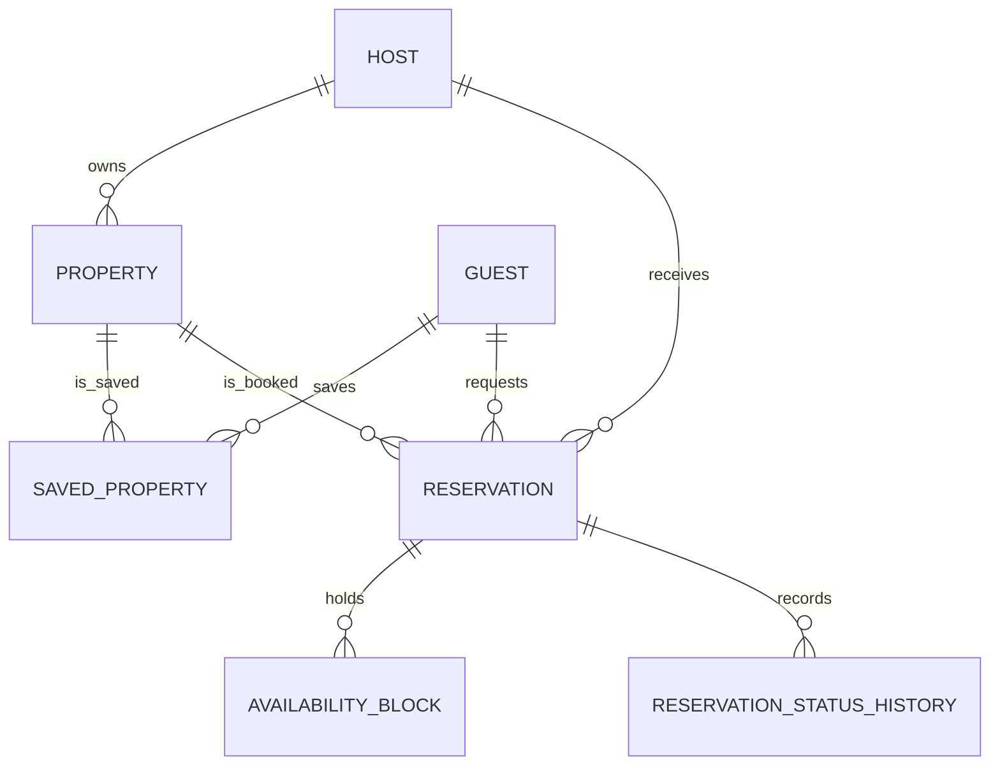

# Core Entity Definitions

Owners: Xuanhua Li (Role A) and Ayushi Shringi (Role B)
Status: Draft for team review

## Purpose

This document defines the shared domain entities used by the User, Property, and Booking services. It keeps field names, identifiers, relationships, and validation rules consistent across service APIs.

Detailed request and response examples remain in:

- `docs/api/user_property.md`
- `docs/api/booking.md`

Operational records such as REST idempotency keys and Kafka processed-event records are documented in the owning API files and are not treated as core domain entities here.

## Shared Data Conventions

- JSON field names use `snake_case`.
- IDs are server-generated opaque strings.
- Reservation IDs use `res-` followed by a ULID.
- Dates use `YYYY-MM-DD`.
- Timestamps use UTC ISO 8601 format.
- `check_in` is inclusive and `check_out` is exclusive.
- Monetary values are represented as JSON numbers and stored as `DECIMAL(10,2)`.
- Cross-service references are logical references. The owning service validates them through internal service interfaces rather than trusting client-provided data.
- Caller identity comes from the authenticated JWT and is not trusted from request bodies.

## Entity Ownership

| Entity | Source of Truth | Storage | Purpose |
|---|---|---|---|
| Guest | User Service | MySQL | Guest profile and search preferences |
| Host | User Service | MySQL | Host profile and verification information |
| Property | Property Service | MySQL | Listing information, price, capacity, and rating aggregate |
| Saved Property | Property Service | MySQL | Guest-to-property saved relationship |
| Reservation | Booking Service | MySQL | Booking request, price snapshot, and status |
| Availability Block | Booking Service | MySQL | Authoritative per-night double-booking guard |
| Reservation Status History | Booking Service | MySQL | Audit history for reservation status changes |
| Availability Result | Property Service | Redis or response projection | Temporary date-range availability result |

## Entity Relationships


```

## Guest

Source of truth: User Service.

| Field | Type | Required | Rule |
|---|---|---:|---|
| `guest_id` | string | Yes | Server-generated and unique |
| `first_name` | string | Yes | 1–100 characters |
| `last_name` | string | Yes | 1–100 characters |
| `email` | string | Yes | Valid email and unique |
| `phone` | string or null | No | E.164 format when present |
| `location` | string or null | No | Maximum 200 characters |
| `profile_photo_url` | string or null | No | HTTPS URL when present |
| `preferences` | object | No | Guest search preferences |
| `saved_properties_count` | integer | Yes | Server-maintained and at least 0 |
| `booking_count` | integer | Yes | Server-maintained and at least 0 |
| `profile_created_datetime` | timestamp | Yes | Server-generated |
| `updated_datetime` | timestamp | Yes | Server-generated |

### Guest Preferences

| Field | Type | Required | Rule |
|---|---|---:|---|
| `property_types` | string[] | No | Values must use supported property types |
| `required_amenities` | string[] | No | Normalized unique values |
| `max_nightly_price` | number | No | Greater than 0 when present |

A guest profile cannot be deleted while the guest has an active reservation. The User Service checks the Booking Service before deletion.

## Host

Source of truth: User Service.

| Field | Type | Required | Rule |
|---|---|---:|---|
| `host_id` | string | Yes | Server-generated and unique |
| `name` | string | Yes | 1–150 characters |
| `email` | string | Yes | Valid email and unique |
| `phone` | string or null | No | E.164 format when present |
| `profile_photo_url` | string or null | No | HTTPS URL when present |
| `verification_status` | string | Yes | `pending`, `verified`, or `rejected` |
| `response_rate` | number | Yes | Server-maintained value from 0 to 1 |
| `response_time` | integer or null | No | Average response time in minutes |
| `host_since` | date | Yes | Server-generated |
| `access_level` | string | Yes | `host` or `admin` |
| `updated_datetime` | timestamp | Yes | Server-generated |

One host can own multiple properties. Only the owning host or an administrator may modify a property.

## Property

Source of truth: Property Service.

| Field | Type | Required | Rule |
|---|---|---:|---|
| `property_id` | string | Yes | Server-generated and unique |
| `host_id` | string | Yes | References an existing host |
| `title` | string | Yes | 5–150 characters |
| `description` | string | Yes | 20–5000 characters |
| `property_type` | string | Yes | `apartment`, `house`, `condo`, `cabin`, or `room` |
| `location` | object | Yes | Address and geographic information |
| `capacity` | integer | Yes | 1–30 |
| `bedrooms` | integer | Yes | 0–20 |
| `bathrooms` | number | Yes | 0.5–20 |
| `amenities` | string[] | Yes | Normalized unique values |
| `nightly_price` | number | Yes | Greater than 0 |
| `cleaning_fee` | number | Yes | At least 0 |
| `availability` | string | Yes | `available`, `partially_available`, or `unavailable` |
| `status` | string | Yes | `draft`, `active`, `suspended`, or `archived` |
| `rating` | number | Yes | Server-maintained value from 0 to 5 |
| `review_count` | integer | Yes | Server-maintained and at least 0 |
| `version` | integer | Yes | Incremented on every update |
| `created_datetime` | timestamp | Yes | Server-generated |
| `updated_datetime` | timestamp | Yes | Server-generated |

### Property Location

| Field | Type | Required | Rule |
|---|---|---:|---|
| `address_line_1` | string | Yes | Street address |
| `city` | string | Yes | City name |
| `state` | string | Yes | State or region |
| `postal_code` | string | Yes | Postal code |
| `country` | string | Yes | Country code |
| `latitude` | number | Yes | Geographic latitude |
| `longitude` | number | Yes | Geographic longitude |

The Property Service consumes `review.created` events to update `rating` and `review_count` idempotently.

The `availability` field is a listing-level summary. It is not the authoritative answer for a requested date range. Date-specific availability must be checked with the Booking Service.

A property cannot be archived while it has an active reservation.

## Saved Property

Source of truth: Property Service.

| Field | Type | Required | Rule |
|---|---|---:|---|
| `guest_id` | string | Yes | References an existing guest |
| `property_id` | string | Yes | References an existing property |
| `saved_datetime` | timestamp | Yes | Server-generated |

The composite pair `(guest_id, property_id)` is unique. Saving the same property again must not create a duplicate relationship.

## Reservation

Source of truth: Booking Service.

| Field | Type | Required | Rule |
|---|---|---:|---|
| `reservation_id` | string | Yes | `res-` followed by a ULID |
| `property_id` | string | Yes | References an existing active property |
| `guest_id` | string | Yes | Taken from the authenticated JWT |
| `host_id` | string | Yes | Copied from the Property Service |
| `check_in` | date | Yes | Inclusive and not in the past |
| `check_out` | date | Yes | Exclusive and later than `check_in` |
| `nights` | integer | Yes | `check_out - check_in`; maximum 30 |
| `guest_count` | integer | Yes | From 1 to the property capacity |
| `nightly_price` | number | Yes | Price snapshot taken at request time |
| `cleaning_fee` | number | Yes | Fee snapshot taken at request time |
| `total_price` | number | Yes | `nightly_price × nights + cleaning_fee` |
| `status` | string | Yes | Reservation lifecycle status |
| `status_reason` | string or null | No | Machine-readable transition reason |
| `message_to_host` | string or null | No | Maximum 1000 characters |
| `cancelled_by` | string or null | No | `guest` or `host` when cancelled |
| `trace_id` | string | Yes | Trace of the original request |
| `publish_pending` | boolean | Yes | Whether an outgoing event still needs publishing |
| `version` | integer | Yes | Incremented on every status change |
| `created_datetime` | timestamp | Yes | Server-generated |
| `updated_datetime` | timestamp | Yes | Server-generated |

The Booking Service copies `host_id`, `nightly_price`, and `cleaning_fee` into the reservation. These values are not accepted from the client. Price snapshots preserve the agreed booking price even if the property price changes later.

### Reservation Status Values

| Status | Meaning | Nights Held |
|---|---|---:|
| `requested` | Accepted and waiting for worker processing | No |
| `pending_host` | Dates held and waiting for the host | Yes |
| `confirmed` | Host approved the reservation | Yes |
| `rejected` | Worker found a date conflict | No |
| `declined` | Host declined the reservation | No |
| `cancelled` | Guest or host cancelled the reservation | No |
| `completed` | Confirmed stay has passed its checkout date | Historical only |

### Allowed Status Transitions

- `requested` → `pending_host`
- `requested` → `rejected`
- `pending_host` → `confirmed`
- `pending_host` → `declined`
- `pending_host` → `cancelled`
- `confirmed` → `cancelled`
- `confirmed` → `completed`

Any other transition is invalid.

An active reservation is a reservation with status `requested`, `pending_host`, or `confirmed` and a `check_out` date of today or later.

## Availability Block

Source of truth: Booking Service.

One availability block represents one held night for one property.

| Field | Type | Required | Rule |
|---|---|---:|---|
| `property_id` | string | Yes | References the reserved property |
| `night_date` | date | Yes | One held night |
| `reservation_id` | string | Yes | References the reservation holding the night |
| `created_datetime` | timestamp | Yes | Server-generated |

The composite primary key is:

```text
(property_id, night_date)
```

This database constraint prevents two reservations from holding the same property night, including when multiple booking workers process requests concurrently.

Availability blocks exist for `pending_host` and `confirmed` reservations. They are released when a reservation is declined or cancelled.

## Reservation Status History

Source of truth: Booking Service.

| Field | Type | Required | Rule |
|---|---|---:|---|
| `id` | integer | Yes | Auto-incremented primary key |
| `reservation_id` | string | Yes | References an existing reservation |
| `from_status` | string or null | No | Previous status; null for initial creation |
| `to_status` | string | Yes | New reservation status |
| `actor_id` | string | Yes | Guest, host, `booking-worker`, or `completion-job` |
| `reason` | string or null | No | Transition reason |
| `trace_id` | string | Yes | Associated request or event trace |
| `changed_datetime` | timestamp | Yes | Server-generated |

Every reservation status transition creates exactly one history record.

## Availability Result

The Availability Result is a read model returned by the Property Service. It may be temporarily stored in Redis, but it is not an authoritative booking record.

| Field | Type | Required | Rule |
|---|---|---:|---|
| `property_id` | string | Yes | References an existing property |
| `check_in` | date | Yes | Inclusive start date |
| `check_out` | date | Yes | Exclusive end date |
| `available` | boolean | Yes | Availability at check time |
| `checked_datetime` | timestamp | Yes | Time of the availability check |
| `source` | string | Yes | `booking_service`, `cache`, or `seed` |

The Property Service invalidates affected Redis entries after consuming `property.availability.updated`.

A positive availability result does not hold the requested dates. The Booking Service must revalidate the dates and create the availability blocks before a reservation can proceed.

## Cross-Service Integrity Rules

1. The User Service owns Guest and Host profile data.
2. The Property Service owns listing data and saved-property relationships.
3. The Booking Service is the only authority for reservation status and date-specific availability.
4. Client requests cannot provide trusted `guest_id`, `host_id`, price snapshots, rating aggregates, or server timestamps.
5. Cross-service IDs are validated through internal service APIs.
6. Property search availability is informational and may be cached.
7. The `(property_id, night_date)` database key is the final double-booking guarantee.
8. Event consumers use idempotency keys so redelivered events do not apply the same change twice.