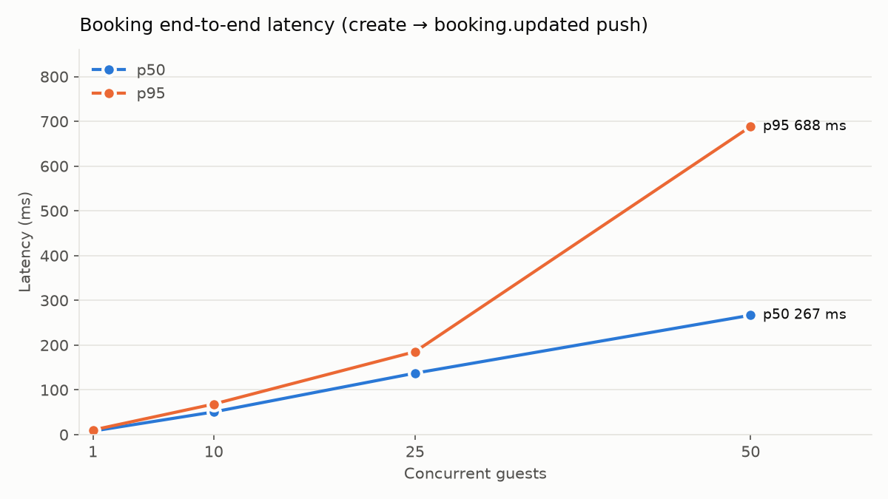
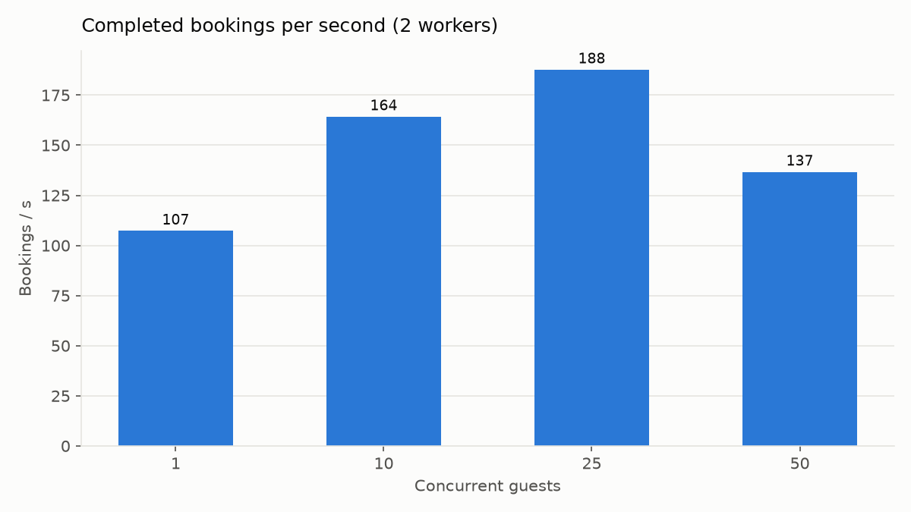
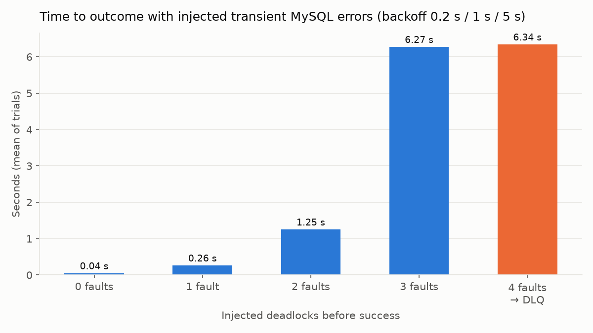

# Booking performance evidence (task 5.2, Role B)

Every number below was produced by `make booking-perf` (`services/booking-api/scripts/perf_booking.py`) on the machine listed at the bottom. Raw data and console output are in this folder (raw process logs are summarized in `logs_summary.md`); nothing was edited by hand.

Run: 2026-11-26 04:35 UTC, git `98792be`.

## 1. End-to-end booking latency

Latency = `POST /bookings/create` sent → `booking.updated` (pending_host/rejected) received on the guest's `WebSocket /bookings/stream`. Each virtual guest has its own WebSocket; every request uses a distinct property/night so the outcome is `pending_host`. 1 API process, 2 worker processes, `booking.requested` with 3 partitions, MySQL/Kafka in Docker on the same laptop.

| Concurrency | Requests | Completed | Errors | Throughput (bookings/s) | p50 (ms) | p95 (ms) | p99 (ms) | max (ms) | HTTP 202 p50 (ms) |
|---:|---:|---:|---:|---:|---:|---:|---:|---:|---:|
| 1 | 50 | 50 | 0 | 107.3 | 7.9 | 10.3 | 13.6 | 13.6 | 5.8 |
| 10 | 60 | 60 | 0 | 164.3 | 50.7 | 68.3 | 72.3 | 74.2 | 10.7 |
| 25 | 150 | 150 | 0 | 187.7 | 137.3 | 185.3 | 188.7 | 191.7 | 11.0 |
| 50 | 300 | 300 | 0 | 136.7 | 266.8 | 688.4 | 970.5 | 1310.8 | 213.0 |





Files: `e2e_latency_summary.csv`, `e2e_latency_raw.csv` (one row per request with trace_id).

## 2. Retry time under injected transient MySQL errors

`WORKER_TRANSIENT_FAULTS=n` makes the worker raise MySQL error 1213 (deadlock) n times before the real transaction. Policy: 3 in-place retries with 200 ms / 1 s / 5 s backoff, then `platform.dlq`. Time = create sent → booking.updated push (0-3 faults) or → DLQ write logged (4 faults).

| Injected faults | Trials | Outcome | Retries logged | Mean (s) | Min (s) | Max (s) |
|---:|---:|---|---:|---:|---:|---:|
| 0 | 3 | pending_host | 0 | 0.04 | 0.04 | 0.05 |
| 1 | 3 | pending_host | 1 | 0.26 | 0.25 | 0.26 |
| 2 | 3 | pending_host | 2 | 1.25 | 1.24 | 1.25 |
| 3 | 3 | pending_host | 3 | 6.27 | 6.27 | 6.28 |
| 4 | 3 | platform.dlq | 3 | 6.34 | 6.30 | 6.40 |



File: `retry_timing.csv`.

## 3. Duplicates after a worker restart

120 bookings at concurrency 10 with 2 workers; `worker-2` was killed with SIGKILL after processing 15 records and restarted 1 s later.

| Metric | Value |
|---|---:|
| Accepted (202) | 120 |
| Final statuses | pending_host: 120 |
| Redeliveries detected by processed_events | 1 |
| Duplicate status-history rows | 0 |
| Reservations with wrong availability_blocks count | 0 |
| processed_events rows (expected = accepted) | 120 |
| booking.updated events on topic / duplicate idempotency keys | 120 / 0 |
| **Duplicate DB side effects** | **0** |

File: `duplicates_after_restart.json`. The deterministic crash-between-commit-and-offset case is in `consumer_recovery/` (`make consumer-recovery`).

## 4. DLQ negative tests

Malformed records produced directly to `booking.requested` (bypassing the API) while 2 workers run.

| Case | Expected error_code | DLQ error_code | retry_count | DLQ records |
|---|---|---|---:|---:|
| not_json | INVALID_JSON | INVALID_JSON | 0 | 1 |
| empty_value | INVALID_JSON | INVALID_JSON | 0 | 1 |
| missing_payload_check_in | INVALID_PAYLOAD | INVALID_PAYLOAD | 0 | 1 |
| guest_count_wrong_type | INVALID_PAYLOAD | INVALID_PAYLOAD | 0 | 1 |
| check_out_before_check_in | INVALID_PAYLOAD | INVALID_PAYLOAD | 0 | 1 |
| missing_envelope_trace_id | INVALID_EVENT_ENVELOPE | INVALID_EVENT_ENVELOPE | 0 | 1 |
| schema_version_2 | INVALID_EVENT_ENVELOPE | INVALID_EVENT_ENVELOPE | 0 | 1 |
| unexpected_top_level_field | INVALID_EVENT_ENVELOPE | INVALID_EVENT_ENVELOPE | 0 | 1 |
| unknown_event_type | UNKNOWN_EVENT_TYPE | UNKNOWN_EVENT_TYPE | 0 | 1 |
| kafka_key_mismatch | EVENT_KEY_MISMATCH | EVENT_KEY_MISMATCH | 0 | 1 |
| reservation_not_found | RESERVATION_NOT_FOUND | RESERVATION_NOT_FOUND | 1 | 1 |

DLQ records: **11 / 11** malformed inputs; reservations table unchanged: True. Files: `dlq_negative_tests.csv`, `dlq_sample_record.json`.

## How to reproduce

```bash
docker compose -f infra/docker-compose.yml up -d kafka mysql   # or: make booking-infra-up
make booking-topics booking-db booking-seed
make booking-perf          # ~3-4 min; stop any manually started booking workers first
```

## Machine

| Item | Value |
|---|---|
| os | macOS-26.6.2-arm64-arm-64bit |
| python | 3.11.18 |
| machine | arm64 |
| cpu | Apple M5 Pro |
| logical_cpus | 15 |
| memory_gb | 24.0 |
| docker | 29.7.2 |
| docker_vm_cpus | 15 |
| docker_vm_memory_gb | 7.7 |
| mysql_image | mysql:8.4 |
| kafka_image | apache/kafka:3.8.1 |
| topic_partitions_booking_requested | 3 |
| workers | 2 |
| git_rev | 98792be |

Note: everything (API, 2 workers, load generator, Docker MySQL + Kafka) ran on one laptop, so the numbers are a lower bound on what separate hosts would give and include load-generator overhead.
