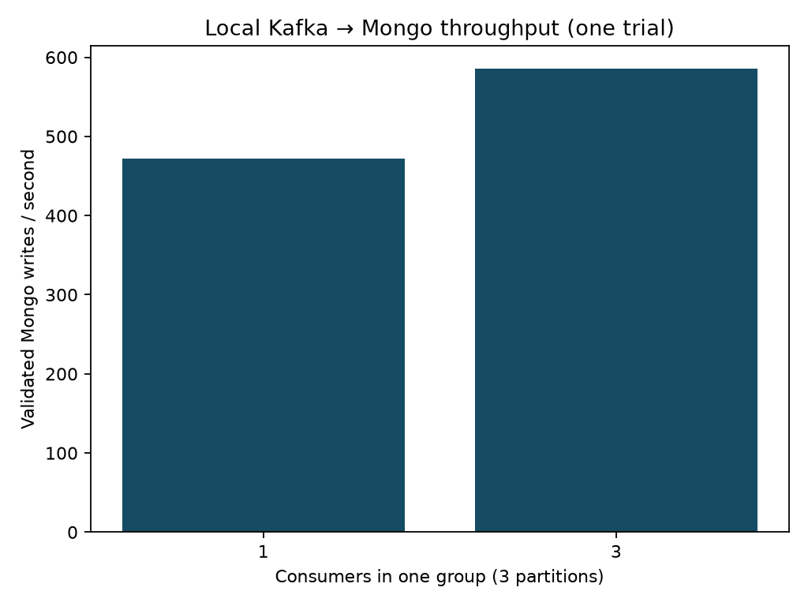

# Kafka performance and platform evidence

Owner: Matthew (Role C). Measured locally on November 27, 2026 (America/Los_Angeles).

## Reproduce

Start Kafka/Mongo using the root compose file, install `services/platform/requirements.txt`, run `make platform-topics`, then `make kafka-perf`. The script retains uniquely named test topics, groups and Mongo databases for auditing. `results.json` identifies every resource. No team data is deleted.

Each configuration uses 600 valid events, 3 invalid JSON records, 3 partitions, a fresh consumer group, the same single local broker and Mongo server. Timing starts after partition assignment and includes publication, schema/key validation, unique Mongo insertion and synchronous offset acknowledgment. Publisher waits for broker acknowledgment. This is one trial per configuration; it does not establish confidence intervals or production capacity.

| Consumers | Valid persisted | Rejected / DLQ verified | Elapsed (s) | Valid records/s |
|---:|---:|---:|---:|---:|
| 1 | 600 | 3 / 3 | 1.2725 | 471.53 |
| 3 | 600 | 3 / 3 | 1.0254 | 585.14 |

Three consumers achieved approximately 1.24 times the throughput in this run. Each consumer received one of the three partitions; the one-consumer run owned all three. Actual assignments, machine details, topic/group/database IDs and timestamps are in `results.json`; numeric plotting input is `throughput.csv`. An earlier development run measured 321.66/858.04 records/s; the final-code rerun is the table above. This variation is why no statistical scaling claim is made.

DLQ totals are checked by consuming the real `platform.dlq` topic and filtering by the benchmark's consumer group, not by trusting an in-memory counter. Malformed data is not retried. Retry and acknowledgment ordering are independently tested in `tests/platform/test_platform.py`.

## Live integration

Run `PYTHONPATH=.:services/platform .venv/bin/python scripts/smoke_platform.py` with Kafka/Mongo running. `smoke.json` records a real HTTP send (201), identical replay (200), Mongo outbox delivered through Kafka, Analytics receipt, a view redelivered twice but stored once, host funnel access with a Booking service token, and rejected guest access to admin platform metrics (403). The script starts/stops its own API and worker processes and retains its isolated database.

## Interpretation and limits

The local stack has replication factor 1. Worker restart safety is tested separately from broker high availability. The throughput experiment includes synchronous offset commits and is sensitive to local Docker load, publication pacing and filesystem/cache effects. Rerun multiple trials on the team's agreed strongest machine before treating the comparison as the final §9 result.
